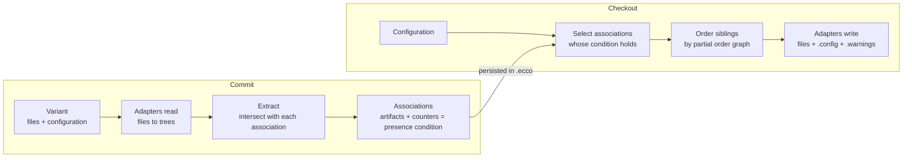

# ECCO - Recovered Requirements

As of 2026-10-21.

## Contents

* [Purpose, scope and method](#purpose-scope-and-method)
* [Stakeholders and usage contexts](#stakeholders-and-usage-contexts)
* [Domain model](#domain-model)
* [Use cases](#use-cases)
* [Functional requirements](#functional-requirements)
* [Artifact adapter requirements](#artifact-adapter-requirements)
* [Interface requirements](#interface-requirements)
* [Non-functional requirements](#non-functional-requirements)
* [Known gaps](#known-gaps)

## Purpose, scope and method

ECCO must let people manage a family of product variants as one repository: commit variants with the features they provide, learn which artifacts implement which features, and compose new variants for feature combinations never committed as such. The name stands for *Extraction and Composition for Clone-and-Own*.

These requirements were recovered, not written up front. ECCO has no requirements specification; it has about 1,400 commits since January 2016, a [README](../README.md), a [changelog](../CHANGELOG.md) that stops at 0.1.9, and the research papers listed in the README. Each requirement below names where it was recovered from:

* **Doc** - stated in the README or a module README.
* **Code** - enforced by the implementation (a check, a refusal, a guard).
* **Test** - asserted by an automated test, the strongest evidence of intent.
* **History** - introduced or fixed by a specific commit; the fix shows what the system was expected to do.

Scope: the live Gradle modules (`base`, `service`, `logic`, `util`, `cli`, `gui`, `rest` and the adapters in `settings.gradle`). The retired storage backends, the `java6`/`java8`/`designspace` adapters and other unbuilt extras are out of scope.

**shall** = required and enforced; **should** = expected but not enforced everywhere.

All requirements - functional, adapter, interface and non-functional - are written in EARS (Easy Approach to Requirements Syntax, Mavin et al., RE'09): *ubiquitous* (the system shall ...), *event-driven* (When ..., the system shall ...), *state-driven* (While ...), *optional* (Where ...) and *unwanted behaviour* (If ..., then the system shall ...). A requirement split into several keeps its old ID with a letter (FR-D8a ...), so the old ID still names the group. *Use case* points to where the requirement is realized: `B3` is step 3 of the basic flow, `SA2` a specific and `BA1` a bounded alternative flow, `post` a postcondition. *Acceptance test* names the tests that check it; *Evidence* the code, document or commit it was recovered from. A requirement that prescribes a design rather than a behaviour is marked *design constraint*; the performance requirements give a *Baseline* instead of a test. A test marked *(unit)* checks the requirement on one class, *(GUI)* through the GUI, not through the service.

Paths are abbreviated: `ES` = `service/.../service/EccoService.java`, `REPO` = `base/.../repository/Repository.java`, `DR`/`DW` = `service/.../adapter/dispatch/DispatchReader.java`/`DispatchWriter.java`, `STS` = `service/.../storage/ser/dao/SerTransactionStrategy.java`, `SR` = `service/.../storage/ser/repository/SerRepository.java`.

## Stakeholders and usage contexts

| Stakeholder | Goal | Front end | Evidence |
| --- | --- | --- | --- |
| Variant developer (clone-and-own) | Keep developing individual variants while reusing features across them | CLI, GUI | README Use Cases; ICSME'14 |
| Product-line engineer | Consolidate existing variants into a common platform; evolve features incrementally | GUI | SPLC'13, SoSyM'16, SST'15 |
| Feature-location researcher | Compute feature-to-artifact traces from known variants; run benchmarks (SPLC challenge, VEVOS) | CLI, `experiment`, challenge adapter | SPLC'19 |
| Distributed team | Exchange features, not whole histories, between repositories | CLI, GUI server | ICSE'16 doctoral symposium |
| Web-client user | Browse and operate repositories from a browser | REST + external [ecco-client](https://github.com/MatthiasPreuner/ecco-client.git) | `rest/README.md` |

The use cases they bring:

1. **Feature location** - given variants with known configurations, compute which artifacts implement which feature.
2. **Extractive product-line engineering** - reverse-engineer a set of variants into a platform.
3. **Automated reuse for clone-and-own** - compose a new variant from features of existing ones.
4. **Reactive/incremental product-line engineering** - evolve variants and individual features over time.
5. **Feature-oriented distributed version control** - fork, pull and push with features as the unit of exchange.

[Use cases](#use-cases) details them as step-by-step scenarios.

## Domain model

The names are the interfaces in `base` (package `at.jku.isse.ecco`).

| Term | Meaning | Code |
| --- | --- | --- |
| Feature | A named unit of functionality; identified by id, the name need not be unique | `feature.Feature` |
| Feature revision | One version of a feature; `A'` creates a new one | `feature.FeatureRevision` |
| Configuration | The set of feature revisions a variant provides, e.g. `Base, Audio, Video.3f2a9c1` | `feature.Configuration` |
| Variant | A working directory's files together with its configuration; can be named and stored | `core.Variant` |
| Commit | One recorded variant: configuration, message, and the associations it touched | `core.Commit` |
| Artifact | One element of an artifact tree (file, line, statement, pixel...) with adapter-specific data | `artifact.Artifact`, `ArtifactData` |
| Node / artifact tree | The tree an adapter reads from files; nodes hold artifacts | `tree.Node`, `RootNode` |
| Association | A set of artifacts that always occurred together across commits | `core.Association` |
| Module / module revision | A feature interaction: positive and negative features (revisions) that co-occurred | `module.Module`, `ModuleRevision` |
| Counter | How often each module revision was seen with an association; the source of its condition | `counter.AssociationCounter` |
| Presence condition | Disjunction of module revisions; holds in a configuration when one of them holds | `module.Condition` |
| Partial order graph | The known orderings of sibling artifacts; ambiguous where commits disagree | `pog.PartialOrderGraph` |
| Feature trace | A presence condition stated up front (e.g. from VEVOS), not learned | `featuretrace.FeatureTrace` |
| Constraint | A mined or accepted relation between features (requires, excludes...) | `core.Constraint` |
| Feature model | The accepted constraints that re-mining still yields (FR-N5) and that have no counterexample (hard, confidence 1.0) - the only constraints ECCO applies | `FeatureModelFormula`, `ConstraintService#acceptedSuggestions` |
| Remote | Another repository, by local path or `host:port` | `core.Remote` |
| Repository | All of the above, stored in a `.ecco` directory | `repository.Repository` |

A commit never stores a variant whole: it splits the artifacts into associations, and a checkout reassembles any configuration whose associations' conditions hold.

## Use cases

The use cases describe the key usage scenarios step by step, with their normal course and their alternatives. They follow RUCM (Restricted Use Case Modeling, Yue, Briand and Labiche, 2009). They are a complement to the requirements: the requirements say what must hold, the use cases say in which order actor and system interact. Each use case names the requirements it realizes.

**Template.** Each use case has a name, a brief description, a precondition, a primary actor, secondary actors, dependencies (INCLUDE USE CASE, EXTENDED BY USE CASE) and generalizations. After these come one basic flow and any number of alternative flows, and each flow ends with a postcondition. RUCM has three kinds of alternative flow:

* A **specific** flow (`RFS n`) branches at one step of the basic flow.
* A **bounded** flow (`RFS n-m`) can start at any of the steps n to m.
* A **global** flow can start at any step.

An alternative flow ends with `ABORT` (the use case ends) or `RESUME STEP n` (the flow continues at step n). This document adds two rows to the template: the front ends that offer the use case and the requirements it realizes.

**Restrictions applied.**

* Each step is one sentence in the simple present and the active voice, with the actor or the system as its subject.
* Steps use no modal verbs and no pronouns.
* There are four kinds of step: the actor requests, the system validates, the system acts internally, and the system replies.
* Conditions and loops use the RUCM keywords: `VALIDATES THAT`, `IF ... THEN ... ELSE ... ENDIF`, `DO ... UNTIL`, `MEANWHILE`.
* The system is written as "the system" whatever the front end.
* Messages in quotes are the system's actual texts.

### Actors

| Actor | Kind | Stakeholder (see above) |
| --- | --- | --- |
| Variant developer | Primary | Variant developer (clone-and-own) |
| Product-line engineer | Primary | Product-line engineer |
| Researcher | Primary | Feature-location researcher |
| Collaborator | Primary | Distributed team |
| Web-client user | Primary | Web-client user, through the external ecco-client |
| Remote repository | Secondary | Another ECCO repository, at a local path or behind a sync server (`host:port`) |
| LLM service | Secondary | Any OpenAI-compatible endpoint configured under Preferences |
| Git clone | Secondary | A local Git repository whose history is imported |

### Overview

| ID | Use case | Primary actor | Front ends | Stakeholder use case |
| --- | --- | --- | --- | --- |
| UC-1 | Initialize repository | Variant developer | CLI, GUI | all |
| UC-2 | Open repository | Variant developer | CLI, GUI | all |
| UC-3 | Commit variant | Variant developer | CLI, GUI | 1-4 |
| UC-4 | Commit several variants | Variant developer | GUI | 1, 2 |
| UC-5 | Check out variant | Variant developer | CLI, GUI | 3, 4 |
| UC-6 | Resolve ambiguous order | Variant developer | GUI | 3, 4 |
| UC-7 | Locate features | Researcher | CLI, GUI | 1 |
| UC-8 | Review mined constraints | Product-line engineer | GUI (CLI read-only) | 2, 4 |
| UC-9 | Minimize presence conditions | Product-line engineer | CLI, GUI | 2 |
| UC-10 | Import Git history | Product-line engineer | GUI | 2, 4 |
| UC-11 | Fork repository | Collaborator | CLI, GUI, REST | 5 |
| UC-12 | Exchange features with a remote | Collaborator | CLI, GUI, REST (pull only) | 5 |
| UC-13 | Serve repository for synchronization | Collaborator | GUI | 5 |
| UC-14 | Commit through the web client | Web-client user | REST | 3 |
| UC-15 | Download variant through the web client | Web-client user | REST | 3 |
| UC-16 | Register a remote | Collaborator | GUI | 5 |

The stakeholder use cases are the five listed under [Stakeholders and usage contexts](#stakeholders-and-usage-contexts): 1 feature location, 2 extractive product-line engineering, 3 automated reuse for clone-and-own, 4 reactive product-line engineering, 5 feature-oriented distributed version control.

### UC-1 Initialize repository

| | |
| --- | --- |
| Brief description | The variant developer creates an empty repository for a directory. |
| Precondition | The session has no open repository. |
| Primary actor | Variant developer |
| Secondary actors | None |
| Dependency | None |
| Generalization | None |
| Front ends | CLI `init` (current directory); GUI Repositories > New |
| Realizes | FR-L1, FR-L2, FR-L4 |

**Basic flow**

1. The variant developer requests a new repository for a directory.
2. The system VALIDATES THAT the directory holds no repository.
3. The system creates the `.ecco` directory.
4. The system stores the defaults from `ecco.properties` in the repository.
5. The system opens the new repository.

Postcondition: An empty repository exists in `<directory>/.ecco` and is open.

**Specific alternative flow SA1** (RFS 2)

1. The system reports "Repository already exists at this location.".
2. ABORT.

Postcondition: The existing repository is unchanged.

**Bounded alternative flow BA1** (RFS 3-5)

1. IF the creation of the repository fails THEN the system removes the half-created repository ENDIF.
2. The system reports the error with its cause.
3. ABORT.

Postcondition: The directory holds no repository, and the variant developer can retry.

### UC-2 Open repository

| | |
| --- | --- |
| Brief description | The variant developer opens an existing repository, which every other use case except UC-1 and UC-11 needs. |
| Precondition | None |
| Primary actor | Variant developer |
| Secondary actors | None |
| Dependency | None |
| Generalization | None |
| Front ends | CLI (each command opens the repository itself); GUI Repositories > Open |
| Realizes | FR-L3, FR-L4, FR-L5, FR-P2, FR-P4, IF-C8, NFR-V1 |

**Basic flow**

1. The variant developer requests to open a directory.
2. The system VALIDATES THAT the directory exists and holds repository data.
3. The system VALIDATES THAT exactly one storage plugin and at least one enabled artifact adapter are available.
4. The system VALIDATES THAT the repository format is supported.
5. The system loads the repository.
6. The system enables the repository operations.

Postcondition: The repository is open, and the system has written nothing.

**Specific alternative flow SA1** (RFS 1)

1. IF the variant developer runs a CLI command THEN the system searches the current directory and its parents for the nearest `.ecco` ENDIF.
2. The system uses the directory that holds `.ecco` as the working directory.
3. RESUME STEP 2.

Postcondition: The repository directory is known.

**Specific alternative flow SA2** (RFS 2)

1. The system reports that the path holds no repository, with a hint at a nested `.ecco` where one exists.
2. ABORT.

Postcondition: The system has written nothing.

**Specific alternative flow SA3** (RFS 3)

1. The system reports the missing storage plugin or the missing enabled adapter.
2. ABORT.

Postcondition: The session has no open repository.

**Specific alternative flow SA4** (RFS 4)

1. The system reports the older or retired format with an explanation.
2. ABORT.

Postcondition: The repository is unchanged.

### UC-3 Commit variant

| | |
| --- | --- |
| Brief description | The variant developer records the files of a working directory as a variant with a configuration; the system splits the artifacts into associations and updates their presence conditions. |
| Precondition | A repository is open (UC-2). The working directory holds the variant's files. |
| Primary actor | Variant developer |
| Secondary actors | None |
| Dependency | Included by UC-4, UC-7, UC-10, UC-14 |
| Generalization | None |
| Front ends | CLI `commit -c <configuration> [-m <message>]` (prints the commit id and any violated constraints); GUI Versions > Commit |
| Realizes | FR-F1 to FR-F8, FR-M1 to FR-M12, FR-P1 to FR-P3, FR-T1, AD-11, IF-C3, IF-C9, NFR-R1, NFR-R3 |

**Basic flow**

1. The variant developer enters a configuration and a commit message for the working directory.
2. IF the configuration is empty THEN the system reads the configuration from `.config` in the working directory ENDIF.
3. The system VALIDATES THAT the configuration is well-formed and names at least one feature.
4. The system VALIDATES THAT the configuration satisfies the accepted constraints.
5. The system begins a read-write transaction.
6. The system reads every file that `.ecco/.ignores` does not exclude, with the adapter that `.ecco/.adapters` maps the file to.
7. The system VALIDATES THAT the repository holds no artifacts in a retired adapter format.
8. The system intersects the artifacts with every association.
9. The system updates the counters of every association that the commit touches.
10. IF the configuration is new THEN the system records the configuration as a variant ENDIF.
11. The system commits the transaction.
12. The system reports success.

Postcondition: The repository holds the commit, and the presence condition of every touched association reflects the configuration. A later checkout of the same configuration reproduces the files (NFR-R3).

**Specific alternative flow SA1** (RFS 3)

1. The system reports the configuration error: invalid syntax, an ambiguous feature name, an unknown feature id, a feature name conditions could not tell from another's (FR-F6), or "A commit needs at least one feature: ... (e.g. BASE).".
2. ABORT.

Postcondition: The repository is unchanged.

**Specific alternative flow SA2** (RFS 7)

1. The system rolls back the transaction.
2. The system reports that the repository holds a retired adapter format and can only be checked out.
3. ABORT.

Postcondition: The repository is unchanged.

**Specific alternative flow SA3** (RFS 4)

1. The system reports each violated constraint as a warning.
2. IF the variant developer works with the GUI THEN the system asks whether to commit despite the violation; IF the variant developer declines THEN ABORT ENDIF ENDIF.
3. RESUME STEP 5.

Postcondition: The violation is advisory (FR-K8): the CLI commits and prints it as `CONSTRAINT:` (IF-C9a); in the GUI nothing is committed unless the variant developer confirms.

**Specific alternative flow SA4** (RFS 6)

1. IF the adapter of a file cannot read the file THEN the system reads the file with the text adapter if the file is text, else with the file adapter ENDIF.
2. The system logs a warning that names the file and the error.
3. RESUME STEP 7.

Postcondition: The file is committed with the fallback adapter and checks out byte for byte (AD-11).

**Bounded alternative flow BA1** (RFS 5-11)

1. IF a file is unreadable, a file maps to a disabled or missing adapter, an adapter cannot run (for example its Python modules are missing), storing fails, or the commit runs out of memory THEN the system rolls back the transaction ENDIF.
2. The system reports the error with its cause; running out of memory is reported with the heap size and how to raise it.
3. ABORT.

Postcondition: The repository is in its state before the commit (NFR-R1).

**Bounded alternative flow BA2** (RFS 5-10)

1. The variant developer cancels the commit.
2. The system stops at the next file it reads and rolls back the transaction.
3. ABORT.

Postcondition: The repository is in its state before the commit, and the next commit runs as usual (FR-M12).

### UC-4 Commit several variants

| | |
| --- | --- |
| Brief description | The variant developer commits several variant folders of one parent folder in a chosen order, typically to consolidate existing clones into a repository. |
| Precondition | A repository is open (UC-2). Each variant folder holds one variant, usually with a `.config`. |
| Primary actor | Variant developer |
| Secondary actors | None |
| Dependency | INCLUDE USE CASE Commit variant |
| Generalization | None |
| Front ends | GUI Versions > Commit Multiple Versions |
| Realizes | IF-G2, FR-M3 |

**Basic flow**

1. The variant developer selects a parent folder.
2. The system VALIDATES THAT the parent folder has subfolders.
3. The variant developer selects the variant folders.
4. The system lists the selected folders with the configuration from each folder's `.config`, on one line.
5. The variant developer orders the folders and edits configurations and commit messages.
6. The system shows the constraint violations of each configuration.
7. The variant developer requests the commit.
8. The system VALIDATES THAT at least one folder is listed.
9. The system VALIDATES THAT no configuration violates an accepted constraint.
10. DO
11. INCLUDE USE CASE Commit variant for the next folder with the folder's configuration and message.
12. The system logs the folder and the commit time.
13. UNTIL every listed folder is committed.
14. The system shows the log and the last commit.

Postcondition: The repository holds one commit per listed folder, in the listed order.

**Specific alternative flow SA1** (RFS 2)

1. The system reports "The selected folder has no subfolders".
2. RESUME STEP 1.

Postcondition: The folder list is unchanged.

**Specific alternative flow SA2** (RFS 8)

1. The system reports "Add at least one folder to commit.".
2. RESUME STEP 1.

Postcondition: Nothing is committed.

**Specific alternative flow SA3** (RFS 9)

1. The system lists the violations and asks for confirmation.
2. IF the variant developer confirms THEN RESUME STEP 10 ELSE RESUME STEP 5 ENDIF.

Postcondition: Nothing is committed yet.

**Bounded alternative flow BA1** (RFS 11-12)

1. IF a commit fails THEN the system shows the error next to the log ENDIF.
2. ABORT.

Postcondition: The folders committed before the failure stay committed; the remaining folders are not committed.

### UC-5 Check out variant

| | |
| --- | --- |
| Brief description | The variant developer composes the variant for a configuration, which may be a feature combination never committed as such, and writes it into an empty working directory. |
| Precondition | A repository is open (UC-2) and holds at least one commit. |
| Primary actor | Variant developer |
| Secondary actors | None |
| Dependency | EXTENDED BY USE CASE Resolve ambiguous order; included by UC-15 |
| Generalization | None |
| Front ends | CLI `checkout -c <configuration> [--minimized]`; GUI Versions > Checkout, Versions > Variants, Explore > Artifacts (Checkout Selected) |
| Realizes | FR-K1 to FR-K10, FR-K12, FR-K13, FR-N9, FR-T2, AD-6, IF-C9 |

**Basic flow**

1. The variant developer enters a configuration for a working directory.
2. The system VALIDATES THAT the configuration is well-formed.
3. The system VALIDATES THAT the working directory is empty apart from `.ecco`.
4. The system begins a read-only transaction.
5. The system selects the associations whose presence condition holds for the configuration.
6. The system prunes the composed artifact tree by the repository's evaluation strategy.
7. The system orders sibling artifacts by the partial order graphs.
8. The system collects MISSING, SURPLUS, ORDER, CONFLICT, UNRESOLVED, CONSTRAINT and TRACE warnings.
9. The system ends the transaction.
10. The system writes the files with the adapters.
11. The system writes `.config` and `.warnings` into the working directory.
12. The system shows the warnings with a suggested fix for each. EXTENDED BY USE CASE Resolve ambiguous order.

Postcondition: The working directory holds the composed variant, `.config` and `.warnings`; the repository is unchanged.

**Specific alternative flow SA1** (RFS 2)

1. The system reports the configuration error.
2. ABORT.

Postcondition: The working directory is unchanged.

**Specific alternative flow SA2** (RFS 3)

1. The system reports that the working directory is not empty or already holds `.config`, `.warnings` or `.hashes`.
2. ABORT.

Postcondition: The working directory is unchanged.

**Specific alternative flow SA3** (RFS 5)

1. IF the variant developer requested minimized conditions THEN the system selects with the stored minimized conditions that are still valid and with the full conditions for the other associations ENDIF.
2. RESUME STEP 6.

Postcondition: The selection equals the selection with full conditions for every configuration that the trusted constraints allow (FR-N9).

**Specific alternative flow SA4** (RFS 12)

1. IF the variant developer works with the CLI THEN the system prints the configuration and the number of warnings of each kind, with a pointer to `.warnings` ENDIF.
2. ABORT.

Postcondition: Same as the basic flow.

### UC-6 Resolve ambiguous order

| | |
| --- | --- |
| Brief description | After a checkout reports an ORDER warning, the variant developer chooses the order of an artifact's children, and the system records the order in the repository without a commit, so that later checkouts know the order. |
| Precondition | A checkout in the GUI (UC-5) reports an ORDER warning. |
| Primary actor | Variant developer |
| Secondary actors | None |
| Dependency | Extends UC-5 at step 12 |
| Generalization | None |
| Front ends | GUI checkout details; CLI `order <file>...` |
| Realizes | IF-G8, IF-C10, FR-K2, FR-K5, FR-K11 |

**Basic flow**

1. The variant developer selects the ORDER warning and requests a reorder.
2. The system shows the children of the artifact, with the pairs whose order earlier commits fixed shown as locked.
3. The system VALIDATES THAT at least one child can move.
4. The variant developer moves children into the intended order.
5. The variant developer confirms the order.
6. The system VALIDATES THAT the order agrees with every order recorded before.
7. The system records the order in the partial order graph of the artifact.
8. The system rewrites the file in the checkout directory in the new order.
9. The system shows the warnings without the resolved ORDER warning.

Postcondition: The repository records the chosen order, and later checkouts that contain these children use it, whatever their configuration. The repository holds no new commit or variant, and the presence conditions and the other warnings are unchanged.

**Specific alternative flow SA1** (RFS 3)

1. The system reports "Nothing to reorder: these children's relative order is already fully determined by prior commits.".
2. The variant developer closes the dialog.
3. ABORT.

Postcondition: The checkout directory and the repository are unchanged.

**Specific alternative flow SA2** (RFS 4)

1. The variant developer asks for a suggested order.
2. The system asks the LLM configured in the preferences for an order of the children around those that can move.
3. The system shows the suggested order, keeping every order earlier commits fixed.
4. RESUME STEP 4.

Postcondition: The dialog shows the suggestion; nothing is recorded until the variant developer confirms. If no model is configured, the system says so instead; if the LLM cannot be reached or answers with no usable order, the system reports it and the order is unchanged.

**Bounded alternative flow BA1** (RFS 4-5)

1. IF the variant developer cancels the dialog THEN ABORT ENDIF.

Postcondition: The checkout directory and the repository are unchanged.

**Specific alternative flow SA4** (RFS 6)

1. The system reports that the order contradicts one recorded before.
2. ABORT.

Postcondition: The checkout directory and the repository are unchanged.

**Specific alternative flow SA3** (RFS 1)

1. IF the variant developer works with the CLI THEN the variant developer puts the content of the checked-out file in the intended order ENDIF.
2. The variant developer runs `order` with the file.
3. The system composes the configuration of `.config` again.
4. The system reads the file with the adapter.
5. IF the file holds content the checkout does not, or lacks content of it, THEN the system reports that content and ABORT ENDIF.
6. The system prints the number of precedences recorded.
7. RESUME STEP 6.

Postcondition: As the basic flow, and the file is already in the new order; after an ABORT the repository is unchanged.

### UC-7 Locate features

| | |
| --- | --- |
| Brief description | The researcher commits variants with known configurations and inspects which artifacts implement which feature or feature interaction. |
| Precondition | A repository is open (UC-2). The researcher has a set of variants with known configurations, for example a VEVOS or SPLC challenge benchmark. |
| Primary actor | Researcher |
| Secondary actors | None |
| Dependency | INCLUDE USE CASE Commit variant |
| Generalization | None |
| Front ends | CLI `traces [id]`, `dg`; GUI Explore > Artifacts (with the association details), association preview, Explore > Dependency Graph |
| Realizes | FR-M1, FR-T1, FR-T2, IF-C6, IF-G6, IF-G7, IF-G9 |

**Basic flow**

1. DO
2. INCLUDE USE CASE Commit variant for the next variant.
3. UNTIL every variant is committed.
4. The researcher requests the associations.
5. The system lists each association with its full and simplified presence condition.
6. The researcher selects associations.
7. The system shows the artifacts of the selected associations in their files, coloured by association.

Postcondition: The researcher has the feature-to-artifact traces; the repository holds the committed variants.

**Specific alternative flow SA1** (RFS 2)

1. IF a variant holds VEVOS presence conditions (`pcs.variant.csv`) and the C, C++ or challenge adapter reads the variant THEN the system records the presence conditions as proactive feature traces ENDIF.
2. RESUME STEP 3.

Postcondition: The proactive traces are stored with their associations; a trace that contradicts the commits is not used, and checkout reports the trace as a TRACE warning (FR-T2).

**Specific alternative flow SA2** (RFS 4)

1. IF the researcher passes an association id to `traces` THEN the system prints the association's presence condition and artifact tree ENDIF.
2. ABORT.

Postcondition: The repository is unchanged.

**Specific alternative flow SA3** (RFS 4)

1. The researcher requests the dependency graph.
2. The system writes the association dependency graph as GML (CLI) or shows the graph for export (GUI).
3. ABORT.

Postcondition: The repository is unchanged.

### UC-8 Review mined constraints

| | |
| --- | --- |
| Brief description | The product-line engineer reviews feature constraints mined from the committed configurations and accepts or rejects them, which builds up a feature model. |
| Precondition | A repository is open (UC-2) and holds commits with different configurations. |
| Primary actor | Product-line engineer |
| Secondary actors | None |
| Dependency | INCLUDE USE CASE Minimize presence conditions |
| Generalization | None |
| Front ends | GUI Explore > Feature Model; CLI `suggest-constraints`, `accept-constraint`, `reject-constraint` |
| Realizes | FR-N1 to FR-N6, IF-C5, IF-G5 |

**Basic flow**

1. The product-line engineer opens the feature model.
2. The system mines MANDATORY, REQUIRES and EXCLUDES constraints per feature from the committed configurations, with the minimum witness count (default 4) and the confidence (default 0.9).
3. The system shows the pending suggestions, which are the mined ones minus the accepted and the rejected ones, hard ones first.
4. The product-line engineer selects suggestions and accepts the selection.
5. The system stores the accepted constraints in the repository in one transaction.
6. INCLUDE USE CASE Minimize presence conditions.
7. The system shows each accepted constraint with the constraint's trust state.

Postcondition: The repository holds the accepted constraints, which travel with fork, pull and push. An accepted constraint is trusted only while re-mining still yields the constraint.

**Specific alternative flow SA1** (RFS 3)

1. The product-line engineer changes the minimum witness count or the confidence.
2. RESUME STEP 2.

Postcondition: The suggestions match the new thresholds.

**Specific alternative flow SA2** (RFS 4)

1. The product-line engineer rejects the selected suggestions.
2. The system stores the rejections in the repository in one transaction, withdrawing an acceptance of the same suggestion.
3. RESUME STEP 3.

Postcondition: The rejected suggestions are no longer proposed, here or in any repository that receives them by fork, pull or push.

**Specific alternative flow SA3** (RFS 4)

1. The product-line engineer moves accepted constraints back to pending.
2. The system removes the constraints from the repository in one transaction.
3. INCLUDE USE CASE Minimize presence conditions.
4. RESUME STEP 3.

Postcondition: The constraints are suggestions again.

**Specific alternative flow SA4** (RFS 1)

1. IF the product-line engineer runs `suggest-constraints` THEN the system prints the pending suggestions and how many are accepted and rejected; with `--all` it also lists the accepted ones with their trust state and the rejected ones ENDIF.
2. IF the product-line engineer runs `accept-constraint` or `reject-constraint` with a kind and its features THEN the system stores the decision as in step 5 or SA2, and with `--undo` moves the suggestion back to pending as in SA3; a feature the repository does not have, or the wrong number of features for the kind, is refused ENDIF.
3. ABORT.

Postcondition: The repository holds the decision; `suggest-constraints` alone leaves it unchanged.

**Specific alternative flow SA5** (RFS 1)

1. IF this machine still holds rejections of an earlier version for the repository THEN the system moves the rejections into the repository, except for suggestions the repository has accepted ENDIF.
2. RESUME STEP 2.

Postcondition: The rejections are stored in the repository and no longer on this machine.

### UC-9 Minimize presence conditions

| | |
| --- | --- |
| Brief description | The product-line engineer simplifies the presence conditions of all associations under the accepted feature model, for reading and optionally for checkout. |
| Precondition | A repository is open (UC-2). |
| Primary actor | Product-line engineer |
| Secondary actors | None |
| Dependency | Included by UC-8 |
| Generalization | None |
| Front ends | CLI `minimize`, `minimize-preview`; GUI "Minimize Presence Conditions" |
| Realizes | FR-N7, FR-N8, FR-N9, IF-C5 |

**Basic flow**

1. The product-line engineer requests the minimization.
2. The system compiles the trusted accepted hard constraints into a feature model.
3. The system minimizes the presence condition of every association, dropping a literal or term only where a SAT check proves the result equivalent under the feature model.
4. The system stores the minimized conditions together with the inputs they were computed from.
5. The system reports the number of associations with stored minimized conditions.

Postcondition: The minimized conditions are stored and are valid until the association's condition, the committed configurations or the accepted constraints change. A checkout with minimized conditions (UC-5 SA3) uses them.

**Specific alternative flow SA1** (RFS 1)

1. IF the product-line engineer requests a preview (`minimize-preview`) THEN the system shows the original and the minimized condition of each association ENDIF.
2. ABORT.

Postcondition: The repository is unchanged.

**Specific alternative flow SA2** (RFS 1)

1. IF a minimization is already running THEN the system ignores the request ENDIF.
2. ABORT.

Postcondition: The running minimization continues.

**Bounded alternative flow BA1** (RFS 2-4)

1. IF the minimization fails THEN the system reports the error ENDIF.
2. ABORT.

Postcondition: The previously stored minimized conditions stay as they were.

### UC-10 Import Git history

| | |
| --- | --- |
| Brief description | The product-line engineer turns the history of a Git repository into ECCO commits, one per Git commit, choosing a configuration for each with help from an LLM. |
| Precondition | A repository is open (UC-2). A local Git clone exists. |
| Primary actor | Product-line engineer |
| Secondary actors | Git clone, LLM service |
| Dependency | INCLUDE USE CASE Commit variant |
| Generalization | None |
| Front ends | GUI Versions > Import from Git |
| Realizes | FR-G1 to FR-G5, IF-G3, IF-G4 |

**Basic flow**

1. The product-line engineer selects a local Git clone.
2. The system VALIDATES THAT the folder holds a `.git`.
3. The system shows the history along HEAD's first parents, oldest first.
4. The product-line engineer selects one continuous range of commits, whether to review each commit, and the use of LLM suggestions.
5. DO
6. The system extracts the tree of the next Git commit into an empty directory.
7. The system VALIDATES THAT each commit is reviewed.
8. The system sends the diff, the message and the features imported so far to the LLM service.
9. The system VALIDATES THAT the LLM service returns a suggestion.
10. The system shows the commit, the files it changed, and a configuration made of the running feature set and the suggestion.
11. The product-line engineer edits the configuration.
12. The product-line engineer chooses Import.
13. The system VALIDATES THAT the configuration satisfies the accepted constraints.
14. INCLUDE USE CASE Commit variant for the extracted tree.
15. The system makes the committed configuration the running feature set.
16. UNTIL the last selected commit is processed.
17. The system shows a summary - commits imported and skipped, accepted constraints violated, suggestions that failed - the log and the last commit.

Postcondition: The repository holds one commit per imported Git commit. The working tree and the index of the Git clone are unchanged.

**Specific alternative flow SA1** (RFS 2)

1. The system reports "Not a git repository (no .git found)".
2. RESUME STEP 1.

Postcondition: Nothing is imported.

**Specific alternative flow SA2** (RFS 7)

1. The system sends the commit to the LLM service.
2. IF the LLM service returns no suggestion THEN the system logs the failure ENDIF.
3. The system takes the running feature set and the suggestion as the configuration.
4. RESUME STEP 14.

Postcondition: The commit is imported without review; a commit that fails is shown for review (SA7).

**Specific alternative flow SA3** (RFS 9)

1. The system shows the commit with the running feature set and the reason the suggestion failed.
2. RESUME STEP 11.

Postcondition: The product-line engineer completes the configuration by hand.

**Specific alternative flow SA4** (RFS 12)

1. The product-line engineer chooses Skip.
2. RESUME STEP 16.

Postcondition: The Git commit is not imported, and the running feature set is unchanged.

**Specific alternative flow SA5** (RFS 12)

1. The product-line engineer chooses Stop.
2. The system logs "Stopped: imported X of Y commit(s).".
3. ABORT.

Postcondition: The commits imported so far stay in the repository.

**Specific alternative flow SA6** (RFS 13)

1. The system asks whether to import the commit despite the constraint violation.
2. IF the product-line engineer confirms THEN RESUME STEP 14 ELSE RESUME STEP 11 ENDIF.

Postcondition: Nothing is committed yet.

**Specific alternative flow SA7** (RFS 14)

1. IF the commit fails THEN the system logs the failure ENDIF.
2. The system shows the commit with the configuration that was tried and the reason for the failure.
3. RESUME STEP 11.

Postcondition: Nothing of the failed commit is in the repository; the product-line engineer corrects the configuration and imports again, or skips the commit.

**Specific alternative flow SA8** (RFS 4)

1. The system reports "Select one continuous range of commits (Shift-click its last one): the commits between would be imported too.".
2. RESUME STEP 4.

Postcondition: Nothing is imported.

**Specific alternative flow SA9** (RFS 8)

1. The repository has no commit yet: the system takes BASE - the code base as first imported, the root of the feature model - as the configuration, without the LLM service.
2. RESUME STEP 10 if the commit is reviewed, else STEP 14.

Postcondition: BASE owns the whole first snapshot.

**Global alternative flow GA1**

1. The product-line engineer closes the window.
2. IF a commit is being suggested or imported THEN the system asks whether to stop the import; IF the product-line engineer declines THEN RESUME at the interrupted step ENDIF ENDIF.
3. The system imports no further commit; a commit already being written finishes.
4. ABORT.

Postcondition: The commits imported so far stay in the repository.

**Specific alternative flow SA10** (RFS 4)

1. The product-line engineer chooses to import the tagged commits only.
2. The system takes BASE as the configuration of the first tagged commit, which brings the commits before it, and leaves out the commits after the last tag.
3. DO
4. The system asks the LLM service for a suggestion for each commit between the last imported tagged commit and the next one, and imports none of them.
5. IF the suggestion for such a commit failed THEN the system shows the commit for review, and the product-line engineer's configuration is used for the next tagged commit ENDIF.
6. The system gives each feature such a commit changed a new revision in the configuration of the next tagged commit.
7. INCLUDE USE CASE Commit variant for the next tagged commit.
8. UNTIL the last tagged commit is imported.
9. RESUME STEP 17.

Postcondition: The repository holds one commit per tagged Git commit - the releases; the commits between were not imported, their changes are new revisions in the next tagged commit, and the summary says how many were left out (IF-G3f/g).

### UC-11 Fork repository

| | |
| --- | --- |
| Brief description | The collaborator creates a new repository from a remote one - its commits, optionally leaving out those with excluded feature revisions. |
| Precondition | The session has no open repository. |
| Primary actor | Collaborator |
| Secondary actors | Remote repository |
| Dependency | None |
| Generalization | None |
| Front ends | CLI `fork <remote> [--exclude ...]`; GUI Repositories > Fork; REST fork with deselected features |
| Realizes | FR-D1, FR-D2, FR-D3, FR-D4, FR-D5, FR-D7, FR-D8, FR-L2, FR-N4, IF-R2 |

**Basic flow**

1. The collaborator enters a remote and the feature revisions to exclude.
2. The system VALIDATES THAT the remote is a local path or a valid `host:port`.
3. The system VALIDATES THAT the target location holds no repository.
4. The system gives the new repository the origin's settings (`.ecco/.settings`), so that it reads files the way the origin's history was read.
5. The system reads the remote repository's commits, with the associations that hold them, its features and its constraints.
6. The system leaves out every commit whose configuration holds an excluded revision.
7. IF nothing is excluded THEN the system copies the remote repository - its commits, modules and associations with their counts ELSE the system commits the remaining commits into the new repository again, in their order, keeping their ids, dates and messages ENDIF.
8. The system stores the result as the new repository.
9. The system registers the remote as `origin`.

Postcondition: The new repository holds the remote's commits except those with an excluded revision; reopened, it checks out every configuration as committing these commits in order would - without exclusions, as the remote does. The remote repository is unchanged (FR-D7).

**Specific alternative flow SA1** (RFS 2)

1. The system reports "Invalid remote address provided.".
2. ABORT.

Postcondition: Nothing is created.

**Specific alternative flow SA2** (RFS 3)

1. The system reports "A repository already exists at the given location".
2. ABORT.

Postcondition: The existing repository is unchanged.

**Specific alternative flow SA3** (RFS SA4 4)

1. The system removes the half-created repository.
2. The system reports "Unresolved dependencies in selection.".
3. ABORT.

Postcondition: Nothing is created.

**Specific alternative flow SA4** (RFS 5-7)

1. IF the remote has merge commits (a fork, pull or push of an older version made them) and revisions are excluded, or the remote is a sync server too old to send its commits THEN the system warns that it merges instead of copying ENDIF.
2. The system reads the remote repository's features, associations and constraints.
3. The system drops the features left without revisions and the modules that contain excluded features.
4. The system VALIDATES THAT the exclusion leaves no unresolved dependencies.
5. The system merges the result into the new repository, one merge commit per association.
6. RESUME STEP 8.

Postcondition: The new repository checks out the remote's content without the excluded revisions, but holds none of its commits.

**Bounded alternative flow BA1** (RFS 4-9)

1. IF the connection or the copy fails THEN the system removes the half-created repository ENDIF.
2. The system reports the error, for example "Error connecting to remote: ...".
3. ABORT.

Postcondition: Nothing is created, and the collaborator can retry.

### UC-12 Exchange features with a remote

| | |
| --- | --- |
| Brief description | The collaborator pulls the commits of a remote this repository does not have, or pushes this repository's commits the remote does not have, optionally leaving out those with excluded feature revisions; fetch only reads the remote's feature list. |
| Precondition | A repository is open (UC-2). The remote is registered (UC-16), by default as `origin`. |
| Primary actor | Collaborator |
| Secondary actors | Remote repository |
| Dependency | None |
| Generalization | None |
| Front ends | CLI `fetch`, `pull`, `push [remote] [--exclude ...]`; GUI Collaborate > Remotes; REST pull between its own repositories |
| Realizes | FR-D1, FR-D3, FR-D4, FR-D5, FR-D7, FR-D8, FR-D9, FR-M9, FR-N4, IF-C4, IF-G10, IF-R4 |

**Basic flow**

1. The collaborator requests a pull from a remote, with the feature revisions to exclude.
2. The system VALIDATES THAT the remote is registered.
3. The system VALIDATES THAT both repositories read the files the pull merges the same way, as their `.ecco/.settings` say.
4. The system reads the ids of the remote's commits.
5. The system reads the remote's commits this repository does not have, with the associations that hold them, leaving out every commit whose configuration holds an excluded revision.
6. The system VALIDATES THAT this repository holds no artifacts in a retired adapter format.
7. The system takes over the remote's accepted and rejected constraints and feature parents.
8. The system commits the commits read into this repository again, after its own and in their order, keeping their ids, dates and messages, in one transaction; a feature of a name this repository has is that feature.
9. The system reports success.

Postcondition: This repository holds its own commits followed by the remote's it did not have and that hold no excluded revision; reopened, it checks out every configuration as committing them in that order would. Pulling again changes nothing. The remote repository is unchanged.

**Specific alternative flow SA1** (RFS 1)

1. The collaborator requests a push to the remote instead.
2. IF the remote has neither a plugin's settings nor files of the plugin THEN the system gives the remote this repository's settings for the plugin ELSE IF the two repositories read the files the push merges differently THEN the system reports the differing settings and ABORT ENDIF ENDIF.
3. The system reads the ids of the remote's commits.
4. The system reads this repository's commits the remote does not have, leaving out every commit whose configuration holds an excluded revision.
5. IF this repository or the remote holds artifacts in a retired adapter format THEN the system reports it as in SA5 and ABORT ENDIF.
6. The system commits them into the remote repository after its own, as in steps 7 and 8; a sync server compares the settings again in the transaction that commits the push, and answers whether it did.
7. RESUME STEP 9.

Postcondition: The remote repository holds its own commits followed by this repository's it did not have and that hold no excluded revision; this repository is unchanged.

**Specific alternative flow SA2** (RFS 1)

1. The collaborator requests a fetch instead.
2. The system reads the remote's features.
3. The system stores the features with the remote's entry.
4. ABORT.

Postcondition: The associations of both repositories are unchanged.

**Specific alternative flow SA3** (RFS 2)

1. The system reports "Remote '<name>' does not exist.".
2. ABORT.

Postcondition: Both repositories are unchanged.

**Specific alternative flow SA4** (RFS SA7 3)

1. The system rolls back the transaction.
2. The system reports "Unresolved dependencies in selection.".
3. ABORT.

Postcondition: Both repositories are unchanged.

**Specific alternative flow SA5** (RFS 7)

1. The system reports that the repository holds a retired adapter format and can only be checked out.
2. ABORT.

Postcondition: Both repositories are unchanged.

**Bounded alternative flow BA1** (RFS 4-8)

1. IF the connection to the remote fails THEN the system rolls back the transaction ENDIF.
2. The system reports "Error connecting to remote: ...".
3. ABORT.

Postcondition: Both repositories are unchanged.

**Bounded alternative flow BA2** (RFS 4-8)

1. The collaborator cancels the fetch, pull or push.
2. The system stops at its next checkpoint and rolls back the transaction.
3. ABORT.

Postcondition: Both repositories are unchanged (FR-D9).

**Specific alternative flow SA6** (RFS 3)

1. IF the remote is a sync server too old to tell its settings THEN RESUME STEP 4 ENDIF.
2. IF the remote cannot tell its settings THEN the system reports that and ABORT ENDIF.
3. IF this repository has neither a plugin's settings nor files of the plugin THEN the system takes over the remote's settings for the plugin, written as a whole before the merge is stored, and RESUME STEP 4 ENDIF.
4. The system reports the differing settings.
5. ABORT.

Postcondition: Both repositories are unchanged, or this repository reads the plugin's files as the remote does.

**Specific alternative flow SA7** (RFS 4-8, SA1 3-6)

1. IF one of the repositories has merge commits (a fork, pull or push of an older version made them), or the remote is a sync server too old to exchange commits THEN the system warns that it merges instead, and that a line can be lost where a configuration was committed again with other content ENDIF.
2. The system reads the sending repository and drops the excluded revisions and the modules that contain the excluded features.
3. The system VALIDATES THAT the exclusion leaves no unresolved dependencies.
4. The system VALIDATES THAT the two repositories have no feature of the same name (FR-F6).
5. The system merges the selection into the receiving repository in one transaction, one merge commit per association.
6. RESUME STEP 9.

Postcondition: The receiving repository holds the union of both repositories' selected content.

### UC-13 Serve repository for synchronization

| | |
| --- | --- |
| Brief description | The collaborator makes the open repository available to other ECCO instances for fork, fetch, pull and push. |
| Precondition | A repository is open (UC-2). |
| Primary actor | Collaborator |
| Secondary actors | Remote repository (the connecting ECCO instance) |
| Dependency | None |
| Generalization | None |
| Front ends | GUI Preferences, server section |
| Realizes | FR-D6, FR-D8, IF-G10, NFR-S1, NFR-S3 |

**Basic flow**

1. The collaborator enters a port (default 3770).
2. The collaborator requests the start of the server.
3. The system VALIDATES THAT no server is running.
4. The system listens on the port of the loopback interface.
5. The system shows "Server running on port P" with a log.
6. DO
7. A remote repository sends a fork, fetch, pull or push request.
8. The system answers the request, deserializing only allow-listed classes and, for a push, comparing the settings in the transaction that commits or merges the push.
9. The system logs the time of the connection and the request.
10. UNTIL the collaborator stops the server.
11. The system stops the server.

Postcondition: The server is stopped. The repository holds what remote repositories pushed.

**Specific alternative flow SA1** (RFS 3)

1. The system reports "Server is already running.".
2. ABORT.

Postcondition: The running server is unchanged.

**Specific alternative flow SA2** (RFS 4)

1. IF the collaborator selected "Accept connections from other machines" THEN the system warns that synchronization has no authentication ENDIF.
2. IF the collaborator confirms THEN the system listens on the port of all interfaces ELSE ABORT ENDIF.
3. RESUME STEP 5.

Postcondition: Any machine that reaches the port can read and push into the repository.

### UC-14 Commit through the web client

| | |
| --- | --- |
| Brief description | The web-client user uploads the files of a variant with a configuration, and the server commits them. |
| Precondition | The REST server runs with a JWT secret and a users file. The web-client user has an account. |
| Primary actor | Web-client user |
| Secondary actors | None |
| Dependency | INCLUDE USE CASE Commit variant |
| Generalization | None |
| Front ends | REST `POST /login`, `POST /api/{repository}/commit/add` |
| Realizes | IF-R1, IF-R3, IF-R6, IF-R7, NFR-S2, NFR-S4, NFR-S5 |

**Basic flow**

1. The web-client user sends a user name and a password.
2. The system VALIDATES THAT the credentials match a user.
3. The system returns a signed bearer token.
4. The web-client user uploads files, a commit message and a configuration for a repository.
5. The system VALIDATES THAT the repository exists.
6. The system VALIDATES THAT the configuration is well-formed and names at least one feature.
7. The system VALIDATES THAT every file name stays inside the repository's upload folder.
8. The system replaces the contents of the upload folder with the files.
9. INCLUDE USE CASE Commit variant for the upload folder, with the web-client user as committer.
10. The system returns the updated repository.

Postcondition: The repository holds the commit.

**Specific alternative flow SA1** (RFS 2)

1. The system reports "Invalid user name or password".
2. ABORT.

Postcondition: The web-client user holds no token.

**Specific alternative flow SA2** (RFS 5)

1. The system returns 404, "repository with the id does not exist".
2. ABORT.

Postcondition: Nothing is written.

**Specific alternative flow SA3** (RFS 6)

1. The system returns 400 with the configuration error.
2. ABORT.

Postcondition: Nothing is written.

**Specific alternative flow SA4** (RFS 7)

1. The system returns 400, "Invalid path: ...".
2. ABORT.

Postcondition: Nothing is written.

**Global alternative flow GA1**

1. IF a request after step 3 carries no valid signed token THEN the system returns 401 ENDIF.
2. ABORT.

Postcondition: The repository is unchanged.

### UC-15 Download variant through the web client

| | |
| --- | --- |
| Brief description | The web-client user downloads a stored variant as a zip file. |
| Precondition | The web-client user holds a token (UC-14 steps 1-3). The repository has a named variant. |
| Primary actor | Web-client user |
| Secondary actors | None |
| Dependency | INCLUDE USE CASE Check out variant |
| Generalization | None |
| Front ends | REST `GET /api/{repository}/variant/{variant}/checkout` |
| Realizes | IF-R5, IF-R6 |

**Basic flow**

1. The web-client user requests the checkout of a variant.
2. The system VALIDATES THAT the repository exists.
3. The system creates a fresh folder.
4. INCLUDE USE CASE Check out variant for the variant's configuration into the folder.
5. The system zips the folder.
6. The system deletes the folder.
7. The system returns the zip file.

Postcondition: The web-client user has the variant's files with `.config` and `.warnings`; the repository is unchanged.

**Specific alternative flow SA1** (RFS 2)

1. The system returns 404.
2. ABORT.

Postcondition: Nothing is written.

**Bounded alternative flow BA1** (RFS 3-5)

1. IF the folder or the zip file cannot be created THEN the system returns 500 ENDIF.
2. ABORT.

Postcondition: The repository is unchanged.

**Global alternative flow GA1**

1. IF the request carries no valid signed token THEN the system returns 401 ENDIF.
2. ABORT.

Postcondition: The repository is unchanged.

### UC-16 Register a remote

| | |
| --- | --- |
| Brief description | The collaborator registers another repository as a remote of the open one, or changes a registered remote, so that fetch, pull and push (UC-12) can name it. |
| Precondition | A repository is open (UC-2). |
| Primary actor | Collaborator |
| Secondary actors | None |
| Dependency | None |
| Generalization | None |
| Front ends | GUI Collaborate > Remotes (the CLI's `remotes` lists them; a fork registers its origin itself, UC-11) |
| Realizes | FR-D1, IF-G10 |

**Basic flow**

1. The collaborator enters a name and an address.
2. The system VALIDATES THAT the address is a local path or a valid `host:port`.
3. The system VALIDATES THAT no remote has the name.
4. The system stores the remote.
5. The system lists the remote.

Postcondition: The remote is registered and can be fetched from, pulled from and pushed to.

**Specific alternative flow SA1** (RFS 1)

1. The collaborator changes the name, address or type of a registered remote instead.
2. RESUME STEP 2.

Postcondition: The remote keeps what was fetched from it.

**Specific alternative flow SA2** (RFS 2)

1. The system reports "Invalid remote address provided.".
2. ABORT.

Postcondition: No remote is stored or changed.

**Specific alternative flow SA3** (RFS 3)

1. The system reports "Remote with this name already exists.".
2. ABORT.

Postcondition: No remote is stored or changed.

## Functional requirements

### Repository lifecycle

| ID | Pattern | Requirement | Use case | Acceptance test | Evidence |
| --- | --- | --- | --- | --- | --- |
| FR-L1a | Event | When the variant developer initializes a repository for a directory, ECCO shall create `.ecco` with the defaults from `ecco.properties` (max order 2, PROACTIVE evaluation, BOOST main tree, `ser` storage) and open it. | UC-1 B3-B5 | `InitCommandTest` | Code ES:870-895 |
| FR-L1b | Unwanted | If a repository is already open, or the directory already holds one, then ECCO shall refuse the init ("Service must not be initialized for init operation.", "Repository already exists at this location.") and leave the existing repository as it was. | UC-1 B2, SA1 | `ExistingRepositoryRefusalTest` | Code ES:1165-1171 |
| FR-L2 | Unwanted | If an init or fork fails, then ECCO shall remove the half-created repository, so that the operation can be retried. | UC-1 BA1; UC-11 SA3, BA1 | `FailedForkCleanupTest`, `OpenNonRepositoryTest` (fork only) | |
| FR-L3a | Unwanted | If the path to open is missing, is not a directory or holds no repository data, then ECCO shall refuse to open it and write nothing. | UC-2 B2, SA2 | `OpenNonRepositoryTest` | History f8cad7e1 |
| FR-L3b | Unwanted | If a path refused for holding no repository data has a nested `.ecco`, then ECCO shall point to it. | UC-2 SA2 | `ForkFromWorkingDirectoryTest` | History f8cad7e1 |
| FR-L4a | Unwanted | If not exactly one storage plugin is configured, then ECCO shall refuse to open the repository with "Exactly one storage plugin must be configured.". | UC-2 B3, SA3 | - | Code ES:386-430 |
| FR-L4b | Unwanted | If no artifact adapter is enabled, then ECCO shall refuse to open the repository with "At least one artifact plugin must be configured.". | UC-2 B3, SA3 | `SmallRefusalsTest` | Code ES:386-430 |
| FR-L5 | State | While no repository is open, ECCO shall refuse every operation with "Service is not initialized.". | - | `VariantsViewTest`, `DependencyGraphViewTest` (GUI) | Code ES:375, `ServiceNotInitializedException` |

### Configurations

| ID | Pattern | Requirement | Use case | Acceptance test | Evidence |
| --- | --- | --- | --- | --- | --- |
| FR-F1a | Ubiquitous | ECCO shall accept as a configuration a comma-separated list of `A` (the latest revision, or a new feature), `A'` (a new revision), `A.<rev>` (that revision) and `[<id>]` (the feature with that id). | UC-3 B3; UC-5 B2; UC-14 B6 | `ConfigurationGrammarTest` | Doc; Code `ConfigurationParser` |
| FR-F1b | Unwanted | If a feature name holds a character other than `[a-zA-Z0-9_-]`, then ECCO shall reject the configuration. | UC-3 SA1; UC-5 SA1; UC-14 SA3 | `SmallRefusalsTest` | Code `Configuration.java:27` |
| FR-F2 | Event | When a configuration names a revision by a prefix of its id of 7 or more characters, ECCO shall resolve the prefix to the revision if no other revision id starts with it. | UC-3 B3; UC-5 B2 | `ShortRevisionIdTest`, `ConfigurationStringRevisionPrefixTest` | History f2e97cc2 |
| FR-F2b | Unwanted | If a revision id in a configuration names no revision of its feature - an unknown id, one shorter than 7 characters (the "2" of `A.2`) or a prefix several revisions share - then ECCO shall read it as a new revision of that feature - which a commit creates and a checkout refuses (FR-K13). | UC-3 B3 | `ShortRevisionIdTest` | Code `ConfigurationParser#findRevisionByIdPrefix` |
| FR-F3 | Unwanted | If a feature name in a configuration is ambiguous, then ECCO shall reject the configuration with a hint to use the feature id. | UC-3 SA1; UC-5 SA1 | `SmallRefusalsTest` | Code `ConfigurationParser:175` |
| FR-F4 | Ubiquitous | ECCO shall not persist revisions when it parses a configuration. | - | `ParseConfigurationPhantomRevisionTest` | |
| FR-F5a | Unwanted | If a configuration selects two revisions of one feature, by name or by id, then ECCO shall reject it as "selected twice". | UC-3 SA1; UC-5 SA1 | `ConfigurationGrammarTest` | Code REPO:509-516 |
| FR-F5b | Ubiquitous | ECCO shall read a revision named twice in a configuration as that revision once. | - | `ConfigurationGrammarTest` | |
| FR-F6 | Unwanted | If a commit or pull would add a feature or revision whose logic variable (`.` and `-` read as `_`) is another's - `shopping-cart` next to `shopping_cart`, `A.B_1` next to `A_B.1`, `A_1` next to `A.1` - then ECCO shall refuse it, because conditions could not tell the two apart. A feature of a pull or push of the same name as one here is that feature (FR-D3f), except in a merge (UC-12 SA7), which refuses it too. | UC-3 SA1; UC-12 SA7 | `FeatureVariableCollisionTest` | Code `FeatureLiterals.checkDistinct` |
| FR-F7a | Ubiquitous | ECCO shall read `[<id>]` in a configuration as the feature's name, in every form (`[<id>]`, `[<id>]'`, `[<id>].<rev>`). | UC-3 B3; UC-5 B2 | `UnknownFeatureIdTest` | |
| FR-F7b | Unwanted | If `[<id>]` names no existing feature, then ECCO shall reject the configuration. | UC-3 SA1; UC-5 SA1 | `UnknownFeatureIdTest` | |
| FR-F8 | Unwanted | If a configuration names a feature that starts with `-` and does not exist (`A, -B`), then ECCO shall reject it with a hint to leave the feature out instead. | UC-3 SA1; UC-5 SA1 | `ConfigurationGrammarTest` | Code `ConfigurationParser:173-177` |

FR-F3 can only meet a repository made before FR-F6 (51523c0d): a pull or push takes a feature of the same name as the one already there, and a merge refuses it, so two cannot arise.

### Commit

| ID | Pattern | Requirement | Use case | Acceptance test | Evidence |
| --- | --- | --- | --- | --- | --- |
| FR-M1 | Event | When the variant developer commits a working directory, ECCO shall read its files through the adapters, extract their artifacts into associations and update the counters, and so the presence condition, of each association the commit touches. | UC-3 B6, B8, B9 | - | Doc; Code `CommitService`, `Repository.extract` |
| FR-M2 | Unwanted | If the configuration of a commit names no feature, then ECCO shall refuse the commit with "A commit needs at least one feature: ...". | UC-3 B3, SA1; UC-14 B6, SA3 | `ImportGitViewRetryTest` (GUI), `SmallRefusalsTest` | Code `CommitService:55`; History 4e150250 |
| FR-M3a | Event | When a commit through the GUI or the service is given no configuration, ECCO shall use the configuration in `<working dir>/.config` (the CLI requires one, IF-C2). | UC-3 B2 | `ConfigFileLineBreaksTest` | Code `CommitService.getConfigStringFromFile` |
| FR-M3b | Unwanted | If `.config` exists but cannot be read, then ECCO shall fail the commit. | - | `SmallRefusalsTest` | Code `CommitService.getConfigStringFromFile` |
| FR-M3c | Event | When ECCO reads a `.config`, it shall collapse the file's line breaks into one line (`a.1, b.1`) and offer that line as the default commit message. | UC-3 B2; UC-4 B4 | `ConfigFileLineBreaksTest` | |
| FR-M4 | Event | When a commit's configuration has not been committed before, ECCO shall record the configuration as a variant. | UC-3 B10 | `CommitVariantReproTest`, `ConfigurationIdentityTest` | Code `CommitService:70-95` |
| FR-M5a | Ubiquitous | ECCO shall skip the files that match `.ecco/.ignores` (by default `.DS_Store` and `.gitignore`). | UC-3 B6 | `DsStoreIgnoredRegressionTest`, `GitignoreIgnoredRegressionTest` | Code DR:31-39 |
| FR-M5b | Ubiquitous | ECCO shall always skip `.ecco`, `.config`, `.warnings` and `.hashes`. | UC-3 B6 | `SmallRefusalsTest` | Code DR:31-39 |
| FR-M6a | Ubiquitous | ECCO shall read each file with the adapter of the first `.ecco/.adapters` line (`pluginId;glob`) whose glob matches the file. | UC-3 B6 | `DispatchReaderPriorityTieTest` | Doc; Code DR:143-197 |
| FR-M6b | Event | When a repository without `.adapters` is opened, ECCO shall write `.adapters` from the adapters' priorities. | - | `DispatchReaderPriorityTieTest` | Doc; Code DR:143-197 |
| FR-M6c | Ubiquitous | ECCO shall keep a repository's `.adapters` once written. | - | `UnavailableAdapterRoutingTest` | Doc; Code DR:143-197 |
| FR-M7a | Unwanted | If a file maps to a disabled or missing adapter, then ECCO shall fail the commit and not read the file with another adapter. | UC-3 BA1 | `UnavailableAdapterRoutingTest` | |
| FR-M7b | Unwanted | If a line of `.adapters` is malformed, then ECCO shall reject it, naming the line. | - | `UnavailableAdapterRoutingTest` | |
| FR-M8a | Unwanted | If a file cannot be read, then ECCO shall fail the commit instead of committing the file empty. | UC-3 BA1 | `UnreadableFileCommitTest` | |
| FR-M8b | Unwanted | If the working directory contains a symlink loop, then ECCO shall skip the loop. | - | `SymlinkLoopCommitTest` | |
| FR-M9 | - | Moved to [NFR-V1](#compatibility-and-evolution) (a commit or merge into a repository of a retired adapter format is refused) and NFR-V2 (it still checks out). | UC-3 B7, SA2; UC-12 B6, SA5 | `CppRoundTripTest` | |
| FR-M10a | Ubiquitous | ECCO shall run a commit in one read-write transaction. | UC-3 B5, B11 | - | Code `CommitService` |
| FR-M10b | Unwanted | If a commit fails, also with an `Error` such as `OutOfMemoryError`, then ECCO shall roll back its transaction. | UC-3 BA1 | `ErrorRollbackTest` | History 2dc75b70 |
| FR-M10c | Unwanted | If a listener fails after a transaction is committed, then ECCO shall keep the transaction committed. | - | `ListenerFailureKeepsCommitTest` | Code `ListenerRegistry:76-82` |
| FR-M10d | Unwanted | If any other operation fails while it holds a transaction, read-only or read-write, then ECCO shall roll the transaction back and pass an `Error` on unwrapped. | - | `ErrorRollbackTest` | History 2dc75b70 |
| FR-M11a | Optional, event | Where a file's adapter names its read context (`ArtifactReader#readContext`: C, C++, TypeScript, Python, Java AST, Markdown, LilyPond), when the file's adapter, path, content (SHA-256) and context are the same as in the session's previous read, ECCO shall copy the tree of that read instead of parsing the file again. | UC-3 B6 | `DispatchReaderReuseTest` | Code DR, `Trees#copyRead`; History 90135e96 |
| FR-M11b | Ubiquitous | ECCO shall store the same for a commit with copied trees as for one with fresh reads. | - | `DispatchReaderReuseTest` | |
| FR-M11c | Optional | Where `-Decco.reuseReadTrees=false` is set, ECCO shall parse every file. | - | `DispatchReaderReuseTest` | Code DR |
| FR-M12a | Event | When the variant developer cancels a commit, ECCO shall stop it at the next file it reads, roll back its transaction and leave the repository as it was. | UC-3 BA2 | `CommitCancellationTest`, `CommitBaseDirViewTest` (GUI) | Code `EccoService#cancelCommit` |
| FR-M12b | Ubiquitous | ECCO shall let a cancellation requested while no commit runs leave the next commit alone. | - | `CommitCancellationTest` | Code `EccoService#cancelCommit` |

A file its enabled adapter fails to parse falls back to another adapter (AD-11, UC-3 SA4). Read-tree reuse does not use `.hashes` - see [Known gaps](#known-gaps) #3.

### Checkout and composition

| ID | Pattern | Requirement | Use case | Acceptance test | Evidence |
| --- | --- | --- | --- | --- | --- |
| FR-K1a | Event | When the variant developer checks out a configuration, ECCO shall select the associations whose presence condition holds for the configuration. | UC-5 B5 | `RepositoryCheckoutTest` | Code REPO:756-763, `CheckoutComposer` |
| FR-K1b | Ubiquitous | ECCO shall prune the composed tree per node by the repository's evaluation strategy (RETROACTIVE, PROACTIVE, PROACTIVE-ADDITION, PROACTIVE-SUBTRACTION). | UC-5 B6 | `EvaluationStrategyCheckoutTest`, `NodeRemovalVisitorTest` (unit) | Code `featuretrace/evaluation` |
| FR-K2a | Ubiquitous | ECCO shall order sibling artifacts by their partial order graph. | UC-5 B7 | `DefaultOrderSelectorTest` (unit), `OrderResolutionCharacterizationTest` | Code `DefaultOrderSelector` |
| FR-K2b | Unwanted | If a partial order graph has a cycle, a redundant transitive edge or a wrong node count, then ECCO shall reject the graph. | - | `PartialOrderGraphCycleCheckEquivalenceTest` (unit, cycles only) | Code `PartialOrderGraph:347-358` |
| FR-K3a | Unwanted | If the working directory of a checkout holds anything besides the repository's own `.ecco` - also only a `.config`, `.warnings` or `.hashes`, or another repository - then ECCO shall refuse the checkout before writing anything. | UC-5 B3, SA2 | `CheckoutIntoNonEmptyDirectoryTest`, `CheckoutViewTest` (GUI) | Code DW:97-111 |
| FR-K3b | - | Merged into FR-K3a: a leftover `.config`, `.warnings` or `.hashes` already makes the directory non-empty; the later checks for them (`CheckoutService`, `DispatchWriter`) cannot be reached. | UC-5 B3, SA2 | `CheckoutIntoNonEmptyDirectoryTest` | |
| FR-K3c | Ubiquitous | ECCO shall recognize the repository directory however it is reached - through a symlink (on macOS `/var` is `/private/var`), a relative path or `./.ecco`. | - | `CheckoutIntoRepositoryHomeTest` | Code `DispatchWriter.isRepositoryDir`; History 8cc349a3 |
| FR-K4 | Event | When ECCO checks out a configuration, it shall write `.config` (the configuration) and `.warnings` into the working directory. | UC-5 B11 | `CheckoutCommandTest` | Doc; Code `CheckoutService:139-167` |
| FR-K5 | Ubiquitous | ECCO shall list the warnings of a checkout in `.warnings`, one per line, with a suggested fix where one exists: the kinds of FR-K5a-f, and TRACE (FR-T2b). | UC-5 B8, B12 | `CheckoutMissingModuleDiagnosticsTest` | Code `CheckoutService` |
| FR-K5a | Event | When a configuration combines features in an interaction never committed, ECCO shall warn MISSING for that interaction. | UC-5 B8 | `CheckoutMissingModuleDiagnosticsTest` | |
| FR-K5b | Event | When a checkout holds artifacts its configuration does not explain, ECCO shall warn SURPLUS for them. | UC-5 B8 | `SurplusLatticeAbsorberTest` | |
| FR-K5c | Event | When the order of sibling artifacts is ambiguous, ECCO shall warn ORDER, naming the undecided lines. | UC-5 B8; UC-6 precondition | `OrderWarningTextTest` | |
| FR-K5d | Event | When a file stored whole has several versions in the combination, ECCO shall not write the file and shall warn CONFLICT. | UC-5 B8 | `WholeFileConflictTest` | Code `WholeFileConflicts` |
| FR-K5h | Event | When a file stored whole has no version for the combination, ECCO shall not write the file, write the other files, and warn CONFLICT for it. | UC-5 B8 | `WholeFileConflictTest` | Code `WholeFileConflicts` |
| FR-K5e | Event | When an association cannot be resolved, ECCO shall warn UNRESOLVED for it. | UC-5 B8 | - | Code `CheckoutService` |
| FR-K5f | Event | When a configuration violates an accepted constraint, ECCO shall warn CONSTRAINT. | UC-5 B8 | `ConstraintViolationWarningTest` | |
| FR-K6 | Ubiquitous | ECCO shall not warn MISSING for an interaction when a smaller sub-combination of it is already missing. | UC-5 B8 | `ModuleRevisionsTest` (unit) | Code `ModuleRevisions.java:38-58` |
| FR-K7a | Optional | Where SURPLUS absorption is on (the default), ECCO shall absorb SURPLUS warnings (X + XY = X). | UC-5 B8 | `SurplusLatticeAbsorberTest` | Code `SurplusLatticeAbsorber` |
| FR-K7b | Optional | Where SURPLUS suppression is on (the default), ECCO shall suppress a SURPLUS warning that the feature model entails. | UC-5 B8 | `SurplusModuleSuppressorTest` (unit), `SurplusModuleSuppressorMultiRevisionTest` | Code `SurplusModuleSuppressor`; History ce32c243 |
| FR-K7c | Ubiquitous | ECCO shall never absorb or suppress MISSING warnings. | - | `SurplusLatticeAbsorberTest`, `SurplusModuleSuppressorTest` (unit) | |
| FR-K7d | Unwanted | If SURPLUS absorption or suppression fails, then ECCO shall log the failure and keep the warnings unreduced. | - | - | Code `SurplusLatticeAbsorber`, `SurplusModuleSuppressor` |
| FR-K8 | Ubiquitous | ECCO shall not block a commit or checkout because of a constraint violation. | UC-3 SA3; UC-4 SA3 | `ConstraintViolationWarningTest` | Code ES:1196-1207 |
| FR-K9 | Ubiquitous | ECCO shall compose a checkout in a read-only transaction. | UC-5 B4, B9 | `ReadWithoutTransactionTest` | |
| FR-K10a | Ubiquitous | ECCO shall write each line-based file in the encoding and line separator of the variant it comes from, ending with a newline as that variant did (AD-6). | UC-5 B10 | `TextFormatVariantsTest`, `MarkdownRepositoryVariantsTest`, `FinalNewlineVariantsTest` | History 8282a32d |
| FR-K10b | Event | When a checkout combines variants in different formats, ECCO shall write the newest commit's format. | UC-5 B10 | `TextFormatVariantsTest`, `TextFormatLastCommitWinsTest` | History 5027fcb0 |
| FR-K10c | State | While a file has no traced format (it was stored before formats were traced), ECCO shall write it in the newest commit's format. | - | - | History 5027fcb0 |
| FR-K11a | Event | When the variant developer records the order of an artifact's children, ECCO shall change only the artifact's partial order graph, without a commit. | UC-6 B7, SA3 | `RecordOrderTest`, `OrderCommandTest` | |
| FR-K11b | Unwanted | If a recorded order contradicts an order recorded before, then ECCO shall refuse it and change nothing. | UC-6 B6, SA4 | `RecordOrderTest` | |
| FR-K11c | Ubiquitous | ECCO shall use a recorded order in every later checkout that contains those children, whatever its configuration. | UC-6 post | `RecordOrderTest`, `OrderResolutionCharacterizationTest` | |
| FR-K12 | Ubiquitous | ECCO shall not check out a file removed in a later commit (for example by renaming its directory) in a variant that does not contain it. | UC-5 B5 | `RemovedFileCheckoutTest` | Code `SerNode.copySingleNodeCompletely`, `Trees.treeFusion`; History d73f17e0 |
| FR-K13 | Unwanted | If a checkout's configuration names a feature or revision the repository does not have (FR-F2b reads it as a new one), then ECCO shall refuse the checkout before writing anything, naming it. | UC-5 B2, SA1 | `UnknownRevisionCheckoutTest` | Code `CheckoutService#checkCommitted` |

FR-K5e and FR-K6 cannot be reached with the adapters and settings in use: a checkout counts an association as unresolved only through a cross reference between artifacts (`Artifact#getUses`, as FR-D4b), which no adapter in use records; and with the maximum order 2 a missing sub-combination would be a single feature never committed, which a checkout refuses (FR-K13) - the maximum order cannot be raised through the service. Their unit tests stay.

FR-K12 holds because a node that only leads to its association's own nodes contributes no condition of its own to the main tree.

### Constraints and condition minimization

| ID | Pattern | Requirement | Use case | Acceptance test | Evidence |
| --- | --- | --- | --- | --- | --- |
| FR-N1a | Event | When the product-line engineer asks for constraint suggestions, ECCO shall mine MANDATORY, REQUIRES and EXCLUDES constraints from the committed configurations. | UC-8 B2, SA4 | `ConstraintMinerTest` (unit), `SuggestConstraintsCommandTest` | Code `ConstraintMiner:80-210` |
| FR-N1b | Ubiquitous | ECCO shall mine with a minimum witness count (at least 1, default 4) and a confidence threshold (0 to 1, default 0.9; 1.0 = hard rules only). | UC-8 B2, SA1 | `ConstraintMinerTest` (unit), `ConstraintSuggestionsViewTest` (GUI) | Code `ConstraintMiner:80-210` |
| FR-N1c | Ubiquitous | ECCO shall list the suggestions hard ones first, then by number of witnesses. | UC-8 B3 | `SuggestConstraintsCommandTest` | Code `ConstraintMiner:80-210` |
| FR-N2 | Ubiquitous | ECCO shall apply a mined constraint only once it is accepted. | UC-8 B3-B5 | `UnacceptedConstraintsTest` | Code `ConstraintMiner` |
| FR-N3 | Ubiquitous | ECCO shall mine constraints per feature, so that revisions of one feature are never mutually exclusive. | UC-8 B2 | `ConstraintMinerTest` (unit), `SuggestConstraintsCommandTest` | Code `ConfigurationBridge` |
| FR-N4a | Event | When the product-line engineer accepts or rejects a suggestion, ECCO shall store the decision in the repository and withdraw an opposite decision on the same suggestion. | UC-8 B5, SA2 | `RejectedConstraintsTest` | |
| FR-N4b | Event | When a fork, pull or push joins two repositories, ECCO shall carry the accepted and rejected constraints and the feature parents over without duplicates, the receiving repository keeping its own decision. | UC-11 B5; UC-12 B7, SA1, SA7 | `ConstraintPersistenceMergeTest`, `RejectedConstraintsTest` | |
| FR-N4c | Event | When a repository is opened on a machine that holds rejections kept by an earlier version, ECCO shall move them into the repository, except for suggestions the repository has accepted. | UC-8 SA5 | `RejectedConstraintsTest` | |
| FR-N5 | State | While re-mining no longer yields an accepted constraint, ECCO shall not trust it. | UC-8 B7, post | `AcceptedConstraintStaleReMineTest` | |
| FR-N6 | Event | When the product-line engineer accepts, rejects or returns several constraints at once, ECCO shall store them in one transaction and fire one event. | UC-8 B5, SA2, SA3 | `ConstraintBatchAcceptTest` | Code `ConstraintService:84-122`; History 04825b26 |
| FR-N7a | Ubiquitous | ECCO shall drop a literal or term of a presence condition only where a SAT check proves the result equivalent under the feature model. | UC-9 B3 | `PresenceConditionMinimizerTest` (unit), `MinimizedCheckoutEquivalenceTest` | Code `PresenceConditionMinimizer` |
| FR-N7b | Event | When the product-line engineer previews a minimization (`minimize-preview`), ECCO shall leave the repository unchanged. | UC-9 SA1 | `MinimizePreviewCommandTest` | Doc |
| FR-N8 | Ubiquitous | ECCO shall show or use a stored minimized condition only while the association's condition, the distinct committed configurations and the accepted constraints it was computed from are unchanged. | UC-9 B4, post | `MinimizedConditionValidityTest` | |
| FR-N9a | Optional | Where a checkout asks for minimized conditions (`checkout --minimized`, GUI preference; off by default), ECCO shall select with the stored revision-exact minimized conditions that are still valid, and with the full conditions otherwise. | UC-5 SA3 | `MinimizeCommandTest` | |
| FR-N9b | Ubiquitous | ECCO shall write the same files with minimized conditions as without them for every configuration the feature model allows. | UC-5 SA3 post | `MinimizedCheckoutEquivalenceTest` | |

### Proactive feature traces

| ID | Pattern | Requirement | Use case | Acceptance test | Evidence |
| --- | --- | --- | --- | --- | --- |
| FR-T1 | Event | When the C, C++ or challenge adapter reads a variant with VEVOS presence conditions (`pcs.variant.csv`), it shall record them as proactive feature traces, with feature names that match the configuration's. | UC-7 SA1 | `CProactiveTraceTest`, `VevosConditionTest` (unit) | Code `VevosConditionHandler`; History f258f279 |
| FR-T2a | Ubiquitous | ECCO shall use a proactive trace only if it holds in every commit containing its association and in no other. | UC-7 SA1 post | `CProactiveTraceCheckTest` | Code `ProactiveTraceCheck`; History 980daf85 |
| FR-T2b | Unwanted | If a proactive trace contradicts the commits, then ECCO shall not use it and shall report it as a TRACE warning (too narrow / too broad) with the commit. | UC-5 B8; UC-7 SA1 post | `CProactiveTraceCheckTest` | Code `ProactiveTraceCheck` |

### Distributed operations

| ID | Pattern | Requirement | Use case | Acceptance test | Evidence |
| --- | --- | --- | --- | --- | --- |
| FR-D1a | Ubiquitous | ECCO shall accept as a remote address a local path to a repository or its `.ecco` directory, or `host:port` with a hostname, an IPv4 address or a bracketed IPv6 address and a port from 1 to 65535. | UC-11 B2, SA1; UC-16 B2, SA2 | `RemoteAddressTest` | |
| FR-D1b | Unwanted | If a remote is added or renamed under a name another remote already has, then ECCO shall refuse with "Remote with this name already exists.". | UC-16 B3, SA3 | `UpdateRemoteTest` | Code `RemoteSyncService:106,141` |
| FR-D2a | Event | When the collaborator forks a remote, ECCO shall create a new repository from the remote and register the remote as `origin`. | UC-11 B5, B8, B9 | `ForkReopenTest` | Code ES:663-800 |
| FR-D2c | Event | When a fork excludes nothing, ECCO shall copy the remote: its commits with their ids, configurations, dates and messages, its modules and associations with their counts - locally and from a sync server. | UC-11 B7 | `ForkCopyTest`, `ForkThenCommitSearchTest` | History 45f6d9f6, 6b3f2a8e |
| FR-D2b | Unwanted | If the location of a fork already holds a repository, then ECCO shall refuse the fork with "A repository already exists at the given location" and leave both repositories as they were. | UC-11 B3, SA2 | `ExistingRepositoryRefusalTest` | Code ES:690, ES:791 |
| FR-D3a | Event | When the collaborator fetches from a remote, ECCO shall read the remote's features and store them with the remote's entry. | UC-12 SA2 | `RemoteSyncCharacterizationTest` | Doc |
| FR-D3b | Event | When the collaborator pulls from a remote, ECCO shall commit the remote's commits this repository does not have into it again, after its own and in their order, so that it checks out every configuration as committing them in that order would. | UC-12 B1-B9 | `DivergedSyncTest`, `RepeatedPullTest`, `DivergedSyncSearchTest`, `RemoteSyncCharacterizationTest` | History fe0fe44c |
| FR-D3c | Event | When the collaborator pushes to a remote, ECCO shall commit this repository's commits the remote does not have into the remote again, after the remote's own and in their order. | UC-12 SA1 | `DivergedSyncTest`, `DivergedSyncSearchTest`, `RemoteSyncCharacterizationTest` | History fe0fe44c |
| FR-D3d | Unwanted | If a fetch, pull or push names a remote that is not registered, then ECCO shall refuse with "Remote '\<name\>' does not exist.". | UC-12 B2, SA3 | `RemoteSyncCharacterizationTest` | |
| FR-D3e | Unwanted | If one of the repositories has merge commits, or the remote is a sync server too old to exchange commits, then ECCO shall merge the repositories as before, and warn that it does. | UC-11 SA4; UC-12 SA7 | `DivergedSyncTest`, `ForkCopyTest` (older server) | Code `RemoteSyncService` |
| FR-D3f | Event | When a pull or push commits a commit whose configuration names a feature by a name the receiving repository has, ECCO shall take it as that feature, adding the revision if the feature lacks it. | UC-12 B8, SA1 | `SmallRefusalsTest` | Code `Repository#adoptConfiguration` |
| FR-D4a | Event | When a fork, pull or push excludes feature revisions, ECCO shall leave out every commit whose configuration holds an excluded revision, and keep the others as committed in the source. | UC-11 B6; UC-12 B5, SA1 | `ExcludedRevisionsTest`, `NetworkSyncSharedFileTest`, `FetchPullLeaveRemoteUnchangedTest` | History fe0fe44c |
| FR-D4b | Unwanted | If, in a merge, an exclusion leaves an artifact without an artifact it references, then ECCO shall refuse the fork, pull or push with "Unresolved dependencies in selection.". | UC-11 SA4, SA3; UC-12 SA7, SA4 | - | Code REPO `subset`, `DependencyGraph` |
| FR-D4c | Event | When a merge's exclusion leaves out the feature that brought a file, ECCO shall keep the other features' lines of the file. | UC-11 SA4; UC-12 SA7 | `ExcludedRevisionsTest` | |
| FR-D4d | Event | When a merge (UC-11 SA4, UC-12 SA7) excludes feature revisions, ECCO shall drop the features left without revisions and the modules that contain an excluded feature, and keep the rest as it checks out in the source. | UC-11 SA4; UC-12 SA7 | - | Code REPO `subset` |

FR-D4a leaves out whole commits: a line only commits with an excluded revision held - also one of another feature, committed together with it - is not in the result. Excluding the only revision of a feature every commit has gives an empty fork.

FR-D4b is reachable only through a cross reference between artifacts (`Artifact#getUses`), which no adapter in use records (only the retired Java 6/8 readers did): `subset()` copies each association's tree whole, so a line never loses its file (FR-D4c).
| FR-D5 | - | Moved to [NFR-R3](#reliability-and-data-integrity) (a fork or pull, reopened, checks out what the source does). | UC-11 post; UC-12 post | `ForkReopenTest` | |
| FR-D6a | Unwanted | If the sync server is started while it is running, then ECCO shall refuse with "Server is already running.". | UC-13 B3, SA1 | `SmallRefusalsTest` | Code `RemoteSyncService:240` |
| FR-D6b | Event | When the sync server deserializes a request, it shall accept only allow-listed classes. | UC-13 B8 | `RemoteSyncServerHardeningTest` | Code `SyncObjectStreams` |
| FR-D6e | Ubiquitous | The sync server shall answer the requests `SETTINGS`, `MERGE_SETTINGS`, `FETCH`, `CLONE` (the repository as stored, for a fork excluding nothing), `COMMIT_IDS` (the ids of its commits and whether it has merge commits), `PULL_COMMITS` (the commits a client lacks, as a repository of their own, or `MERGE`), `PUSH_COMMITS` (commits to commit after its own) and, for older clients, `PULL` and `PUSH`. | UC-13 B7, B8 | `ForkCopyTest`, `DivergedSyncTest`, `SyncProtocolHardeningTest`, `NetworkSyncSharedFileTest` | Code `RemoteSyncService` |
| FR-D6c | Unwanted | If the sync server receives a request it cannot read, also one nested too deeply, then it shall drop that request and keep serving. | - | `SyncProtocolHardeningTest` | |
| FR-D6d | Unwanted | If the sync server's channel closes other than by stopping the server - its thread interrupted, say - then the server shall stop instead of accepting on. | - | `RemoteSyncServerHardeningTest` | Code `RemoteSyncService#startServer` |
| FR-D7 | Ubiquitous | ECCO shall leave the remote repository unchanged by a fork, fetch or pull, also when revisions are excluded or the operation fails. | UC-11 post; UC-12 post, SA2-SA5 post, BA1 post | `ForkLeavesOriginUnchangedTest`, `FetchPullLeaveRemoteUnchangedTest` | |
| FR-D9 | Event | When the collaborator cancels a fetch, pull or push, ECCO shall stop it at its next checkpoint before anything is written, roll back its transaction and leave both repositories as they were. | UC-12 BA2 | `CancelRemoteSyncTest` | Code `RemoteSyncService`, `OperationCancelledException` |

ECCO merges only files that both repositories read the same way, as their `.ecco/.settings` say:

| ID | Pattern | Requirement | Use case | Acceptance test | Evidence |
| --- | --- | --- | --- | --- | --- |
| FR-D8a | Event | When the collaborator forks a remote, ECCO shall give the new repository the origin's settings, also from a sync server. | UC-11 B4 | `LilypondSettingsSyncTest` | |
| FR-D8b | Event | When a pull or push merges a plugin's files into a repository that has neither that plugin's settings nor its files, ECCO shall give the receiving repository the sender's settings for that plugin. | UC-12 SA6, SA1 | `LilypondSettingsSyncTest` | |
| FR-D8c | Unwanted | If the two repositories' settings differ otherwise, then ECCO shall refuse the pull or push before merging anything, naming the differing settings. | UC-12 B3, SA6, SA1 | `LilypondSettingsSyncTest` | |
| FR-D8d | Unwanted | If a sync server is too old to tell its settings, then ECCO shall sync with it without comparing settings. | UC-12 SA6 | - | Code `RemoteSyncService:627-660` |
| FR-D8e | Unwanted | If a sync server cannot tell its settings, then ECCO shall report that and sync nothing. | UC-12 SA6 | `SyncProtocolHardeningTest` | |
| FR-D8f | Event | When the sync server receives a push, it shall compare the settings in the transaction that merges the push and answer whether it merged it. | UC-13 B8; UC-12 SA1 | `SyncProtocolHardeningTest` | |
| FR-D8g | Ubiquitous | ECCO shall write settings it takes over as a whole, before the merge is stored. | UC-12 SA6 | `SyncProtocolHardeningTest` | |

### Git import

| ID | Pattern | Requirement | Use case | Acceptance test | Evidence |
| --- | --- | --- | --- | --- | --- |
| FR-G1a | Ubiquitous | ECCO shall read a Git clone without touching its working tree, its index or the rest of `.git`, also with uncommitted, staged and untracked changes in it. | UC-10 post | `GitImportLeavesCloneUntouchedTest` | Code `git/GitHistoryReader` |
| FR-G1b | Ubiquitous | ECCO shall import the commits of HEAD's first-parent line oldest first (as `git log --first-parent`), leaving out the commits of merged branches - the merge commit brings their work. | UC-10 B3, B5 | `GitHistoryReaderTest` (unit), `ImportGitViewTaggedTest` (GUI) | Code `git/GitHistoryReader` |
| FR-G2a | Event | When ECCO imports a Git commit, it shall extract the commit's tree into an empty directory. | UC-10 B6 | `GitHistoryReaderTest` (unit) | Code `GitHistoryReader` |
| FR-G2b | Ubiquitous | ECCO shall skip submodules when it extracts a Git tree. | UC-10 B6 | `GitHistoryReaderTest` (unit) | |
| FR-G2c | Unwanted | If an entry of a Git tree would be extracted outside the directory, then ECCO shall refuse it. | UC-10 B6 | `GitHistoryReaderTest` (unit) | |
| FR-G2d | Unwanted | If the folder chosen for Git import holds no `.git`, then ECCO shall refuse it with "Not a git repository (no .git found)". | UC-10 B2, SA1 | `GitHistoryReaderTest` (unit) | Code `GitHistoryReader:341`, `ImportGitView` |
| FR-G3a | Optional | Where LLM suggestions are on, ECCO shall send one request per commit (temperature 0, JSON output), judged against the features imported so far. | UC-10 B8 | `LlmFeatureSuggestionClientTest` (unit) | Code `LlmFeatureSuggestionClient:398-410` |
| FR-G3b | Unwanted | If an LLM request fails, then ECCO shall give a blank suggestion and go on with the import. | UC-10 B9, SA2, SA3 | `ImportGitViewSuggestionLogTest` (GUI) | Code `LlmFeatureSuggestionClient` |
| FR-G3c | Ubiquitous | ECCO shall commit a suggestion only on the import loop's decision. | UC-10 B10-B12, SA2 | - | |
| FR-G4a | Unwanted | If a Git commit fails to import, then ECCO shall show it again for review with the error and the configuration tried, to be corrected and imported again or skipped. | UC-10 SA7 | `ImportGitViewRetryTest` (GUI) | |
| FR-G4b | Unwanted | If a Git commit fails to import, then ECCO shall keep nothing of it and go on with the run. | UC-10 SA7 post | `ImportGitViewRetryTest` (GUI) | |
| FR-G5 | Event | When ECCO imports the first commit into a repository without commits, it shall take BASE - the code base as first imported, the root of the feature model - as its configuration, without asking the LLM. | UC-10 SA9 | `ImportGitViewTaggedTest` (GUI) | Code `ImportGitView`, `LlmFeatureSuggestionClient.BASE` |

### Persistence (`ser` storage)

| ID | Pattern | Requirement | Use case | Acceptance test | Evidence |
| --- | --- | --- | --- | --- | --- |
| FR-P1 | Ubiquitous | ECCO shall store a repository in `.ecco` as a core file (`<id>.ser.zip`, the current one named by the file `id`: features, constraints, modules, commits, the ids of the associations, the packs in the order they were written and each pack's size, the counted module revisions) and packs: the artifacts in `artifacts/`, the associations in `associations/`, the pieces of their trees in `pieces/`. | UC-3 B11 | `AssociationPacksTest`, `TreePiecesStorageTest` | Code STS, SR |
| FR-P2a | Ubiquitous | ECCO shall keep no entry per artifact in the core. | - | - | Code SR (`packOrder`), STS; History 6dc69da5 |
| FR-P2b | Event | When ECCO loads a repository, it shall read the packs in the order they were written, a later pack's copy of an artifact superseding an earlier one's, and rebuild in memory which pack holds each artifact's current copy. | UC-2 B5 | `ArtifactPackTest`, `ReopenEquivalenceTest` | Code SR, STS; History 6dc69da5 |
| FR-P3a | Event | When a commit is stored, ECCO shall write one new pack with only the artifacts whose serialized bytes differ from their stored ones, compared by a digest kept per artifact id. | UC-3 B11 | `UnchangedArtifactRewriteTest`, `ArtifactPackTest` | Code STS `writeArtifactPack` |
| FR-P3b | Event | When a pack keeps fewer than half of its artifacts current, ECCO shall repack them into the new pack. | UC-3 B11 | `ArtifactPackTest` | Code STS `writeArtifactPack` |
| FR-P3c | State | While there are more than 20 packs, ECCO shall merge the smallest. | UC-3 B11 | `ArtifactPackTest` | Code STS `writeArtifactPack` |
| FR-P4 | - | Moved to [NFR-V3](#compatibility-and-evolution) (an older storage layout is refused on open, naming the version that converts it). | UC-2 B4, SA4 | `OldStorageFormatTest` | |

## Artifact adapter requirements

An adapter reads files of one kind into artifact trees and writes them back. The finer its trees, the more precisely features are traced. Fidelity differs by adapter: the line-based adapters (text, Markdown, C, C++) are byte-exact, and so are TypeScript and LilyPond for a variant checked out as committed; the Java (AST) and Python adapters are not.

### Contract for every adapter

| ID | Pattern | Requirement | Use case | Acceptance test | Evidence |
| --- | --- | --- | --- | --- | --- |
| AD-1a | Ubiquitous | An adapter shall be an `ArtifactPlugin` registered through `ServiceLoader` that binds its reader, writer and optional viewers through Guice. | - | - | Code; `adapter/README.md` |
| AD-1b | Ubiquitous | An adapter's `getPluginId()` shall return its plugin class name. | - | `FileReaderTest`, `CReaderWriterTest`, `CppReaderWriterTest` (unit) | Code |
| AD-2a | Ubiquitous | A reader shall return one root node per file, carrying `PluginArtifactData`. | UC-3 B6 | - | Code DR |
| AD-2b | Ubiquitous | ECCO shall choose the writer of a file by the plugin id of its root node. | UC-5 B10 | - | Code DW |
| AD-3a | Ubiquitous | A reader shall declare prioritized glob patterns, from which `.adapters` is first written (FR-M6b). | - | `DispatchReaderJavaPluginPriorityTest` | Code |
| AD-3b | Unwanted | If enabled adapters tie on priority, then ECCO shall prefer one by plugin id and log the tie. | - | `DispatchReaderPriorityTieTest` | Code |
| AD-4 | Ubiquitous | ECCO shall let each user enable or disable adapters (at least one: FR-L4b; in the GUI: IF-G11). | - | `PreferencesViewTest` (GUI) | Code `AdapterPreferences`, ES |
| AD-5 | State | While ECCO runs headless (`ecco.headless`), it shall not bind adapter viewers. | - | `InitCommandTest` | Code; History bfcddc23 |
| AD-6a | Ubiquitous | The text, Markdown, C and C++ adapters shall round-trip a file byte-exact: its encoding (UTF-8, else ISO-8859-1), line separator and final newline, each per variant (how a checkout writes them: FR-K10a-c). | UC-3 post; UC-5 B10 | `TextFileFormatTest` (5,000 random rounds), `TextFormatVariantsTest`, `FinalNewlineVariantsTest` | History 8282a32d, 5027fcb0 |
| AD-6b | Ubiquitous | These adapters shall trace a file's final newline per variant (`FinalNewlineArtifactData`, the last child of the file's node), and its encoding and line separator per variant (`TextFormatArtifactData`, after the final newline; not for an empty file). | - | `FinalNewlineVariantsTest`, `TextFormatVariantsTest` | History 8282a32d, 5027fcb0 |
| AD-6c | Ubiquitous | For a file that mixes line separators, these adapters shall keep the separators per line and per variant. | - | `MixedLineSeparatorsTest` | Code `TextFormatArtifactData` |
| AD-7 | Event | When an adapter's tree format changes, the adapter shall mark the old data with `retiredFormat()` or a tree-format check (NFR-V1). | - | `CppRoundTripTest` | Code `ArtifactData#retiredFormat`, `JavaASTData.TREE_FORMAT`, `cpp/data/RetiredFormat` |
| AD-8 | Ubiquitous | An adapter that needs Python shall pick a free py4j port. (A missing Python fails the commit: AD-11b.) | - | `PythonGatewayPortTest`, `LilypondGatewayPortTest` | |
| AD-9a | Ubiquitous | An adapter that needs Python shall run the interpreter set in Preferences, else the first of `python`, `python3` and the usual install locations (MacPorts, Homebrew, python.org, `/usr/local/bin`, `/usr/bin`) that imports its modules - libcst and py4j for Python; tree-sitter, py4j and lymodel for LilyPond, lymodel from the lymodel directory in Preferences, `LYPYTHON` or installed - not rely on `python` on the PATH. | - | `PythonFinderTest`, `LilypondPythonTest` | Code `PythonFinder`, `LilypondPython`, `PY4JParser.python()`; History d8c8ac60, 6765398d |
| AD-9b | Unwanted | If no interpreter will do, then the adapter shall name each interpreter tried and what it lacks. | UC-3 BA1 | `PythonFinderTest` | Code `PythonFinder` |
| AD-9c | Event | When a module is installed after a failed lookup, the adapter shall find it without a restart. | - | - | History 143e32cb |
| AD-10a | Ubiquitous | The LilyPond adapter shall read with lymodel's tree-sitter parse and record it in a new repository's settings (`lilypond.parser=lybar-2`). | - | `LilypondRepositorySettingsTest`, `LilypondParseTest` | Code `LilypondPlugin.PARSER_SETTING`, `LilypondParser_2.py`; History 4b95ee97, 143e32cb |
| AD-10b | Unwanted | If a repository's LilyPond files were read with an earlier parse (no parser setting: parce; `lybar-1`), then ECCO shall refuse a commit to it with an explanation before anything is written, and still check its files out. | - | `LilypondRepositorySettingsTest` | Code `LilypondReader#readable` |
| AD-10c | Event | When a repository with neither LilyPond settings nor LilyPond files is next committed to, ECCO shall give it the settings of a new repository. | - | `LilypondRepositorySettingsTest` | Code `EccoService#adoptRepositorySettings` |
| AD-11a | Unwanted | If an enabled adapter cannot read a file, then ECCO shall read it with the text adapter if it is text (no NUL byte in its first 8 KB), else with the file adapter, both byte-exact, and warn, naming the file and the error. | UC-3 SA4 | `DispatchReaderFallbackTest` | History 86ea679c |
| AD-11b | Unwanted | If an adapter cannot run at all (no Python or Python modules, a repository made for another version of it: `AdapterUnavailableException`) or the commit is cancelled, then ECCO shall fail the commit instead of falling back, never committing an empty file. | UC-3 BA1 | `DispatchReaderFallbackTest` | Code DR |

AD-10b: parce's tokens and contexts would never match those of the tree-sitter parse, and `lybar-1` tokens do not record whether they were written together with the one before them, which is part of a token's identity since `lybar-2`. AD-11a covers, for example, a `.json` with comments, a Git LFS pointer named `.png` and a construct an adapter does not know.

### Per adapter

| Adapter | Files | Granularity | Fidelity required | On by default | Evidence |
| --- | --- | --- | --- | --- | --- |
| File | everything else | whole file | byte-exact | yes | `FileReaderTest`, `FileWriterTest` |
| Text | `.txt .xml .html .css .js .java` | lines | byte-exact, also mixed line separators, per variant | yes | `TextReaderTest`, `TextFileWriterTest`, `TextRoundTripTest`, `TextFormatVariantsTest` |
| Markdown | `.md .markdown` | CommonMark/GFM blocks, nested by heading | byte-exact, per variant | yes | `MarkdownReaderTest`, `MarkdownFileWriterTest`, `MarkdownRoundTripPropertyTest` (2,000 generated documents), `MarkdownConstructsRoundTripTest`, `MarkdownRepositoryVariantsTest` (30 single-aspect and 150 random variant pairs) |
| Image | `.png .jpg .jpeg .bmp .gif` | pixels (one artifact each: a 4-megapixel PNG takes 230 s, 9 GB and 1 GB stored per commit; README "Images" maps images to the file adapter) | exact colours for PNG/BMP, also gray levels of grayscale images; 8 bits per channel (16-bit images lose their low bits); JPEG lossy; never an empty file | yes | `ImageFormatWriteTest`, `ImageRoundTripTest` |
| Java (AST) | `.java` | JavaParser AST, Java 21 level; an enum's constants an ordered group (tree format 2: repositories of an older format checkout-only) | comments kept, also inside lambdas, expressions, call arguments, try resources, catch and constructor parameters, case labels and on module directives, except a few, e.g. in an `if` condition, a field's initializer or a method's header; braces, `synchronized`, arrow cases, case guards, `case null, default`, enum constant annotations and order kept; layout pretty-printed, not byte-exact | yes | `JavaASTCommentTest`, `JavaASTPartCommentTest`, `JavaASTStatementFidelityTest`, `JavaASTTreeFormatTest`, `JavaASTRoundTripTest`, `JavaASTRepositoryRoundTripTest`, `JavaASTVariantEqualityTest` |
| C | `.c .h` | lines grouped by function (a function starting on the line another ends on stays lines); `#if` as lines; VEVOS traces | byte-exact incl. blank lines, CRLF, Latin-1, per variant | yes | `CRoundTripTest`, `CRepositoryRoundTripTest` |
| C++ | `.cpp .hpp` (+ `.c .h` when C is off) | lines grouped by namespace, class, enum, function | byte-exact incl. include guards and comments, per variant; first format checkout-only | yes | `CppRoundTripTest`, `CppRoundTripPropertyTest` (2,000 generated files), `CppRepositoryRoundTripTest`, `LegacyCppWriterTest` (repositories committed with the first format) |
| TypeScript | `.ts` | statements and blocks (TS compiler in embedded Node.js) | exact text incl. `;`, trailing comments, JSDoc, declarations without a body or initializer (`.d.ts`, overloads), empty blocks, enums and classes; switch/enum order kept - 161 real files (28 of flipperzero-firmware) byte for byte | yes | `TypeScriptRoundTripTest`, `TypeScriptOrderTest` |
| Python | `.py .ipynb .json` | libcst syntax tree; notebook cells; JSON values | not byte-exact: whitespace-only lines normalized, JSON re-indented, notebook outputs ignored | yes | `PythonAdapterTest` |
| LilyPond | `.ly .ily` | tokens from lymodel's tree-sitter parse (parce before `lilypond.parser=lybar-1`, AD-10; since `lybar-2` a token records whether it was attached to the one before it); with musical tokens each note one token carrying its meaning, and with variable contexts each top-level assignment a context of its name | byte-exact incl. tabs, CRLF and blank lines when checked out as committed: a token keeps the whitespace it was read with after the token before it (not part of its identity) - all 724 corpus and example files with musical tokens (the default), and all 705 corpus files read without them; where a checkout puts a token after another one, the writer's rules space it, and the music is the same (judged by lymusic: all 719 files it reads); tokens stored before keep the writer's rules | yes | `LilypondParseTest`, `LilypondVariantsCommitCheckoutTest` |
| Go | `.go` | tokens (ANTLR) | exact reconstruction | **no** | `GoWriterTest` |
| Runtime | `.runtime .java` | Java classes/methods/lines + btrace data | not format-preserving | **no** | `RuntimeWriterTest` |
| Java (lines) | `.java` | class, imports, members, statements | read-only: checkout refused | **no** | `JavaWriterTest` |
| Challenge | `.java` | class, method, line + VEVOS traces | read-only: checkout refused | **no** | `ChallengeReader*Test` |

## Interface requirements

Three front ends sit on one service API (`EccoService`): a CLI for scripting and experiments, a JavaFX GUI for exploration, and a REST server for the external web client. They do not offer the same operations; the matrix at the end shows where they differ.

### Command line (`cli`)

| ID | Pattern | Requirement | Use case | Acceptance test | Evidence |
| --- | --- | --- | --- | --- | --- |
| IF-C1 | Ubiquitous | The CLI shall offer `init`, `status`, `adapters`, `commit -c [-m]`, `checkout -c [--minimized]`, `features`, `traces`, `get`/`set`, `remotes`, `fork`, `fetch`, `pull`, `push`, `dg`, `suggest-constraints`, `accept-constraint`, `reject-constraint`, `minimize-preview`, `minimize` and `order`. | Front ends of UC-1 to UC-12 | one test per command (`cli/.../command`) | Code `Main.registerCommands()` |
| IF-C2 | Unwanted | If `commit` or `checkout` is run without a configuration (`-c`), then the CLI shall refuse it as invalid arguments. | - | `MainExitCodeTest` | Code `Main.java:180,188` |
| IF-C3a | Ubiquitous | The CLI shall exit with 0 on success, 1 on a failed command and 2 on invalid arguments. | - | `MainExitCodeTest` | Code `Main.run` |
| IF-C3b | Unwanted | If a command fails, then the CLI shall write the error with its cause chain to stderr, with the stack trace only under `-Decco.debug=true`. | UC-3 BA1 | `MainExitCodeTest` | Code `Main.run` |
| IF-C3c | Unwanted | If closing the repository fails after a command, then the CLI shall attach that failure to the command's own error, not show it in its place. | - | `CommitCommandTest` | Code `Command#withOpenRepository`; History 2dc75b70 |
| IF-C3d | Unwanted | If a command runs out of memory, then the CLI shall say so, with the heap size and how to raise it (`JAVA_OPTS=-Xmx16g`). | UC-3 BA1 | `CommitCommandTest` | History 2dc75b70 |
| IF-C4a | Ubiquitous | `fetch`, `pull` and `push` shall use the remote `origin` when given none. | UC-12 precondition | `MainArgumentsTest` | Code |
| IF-C4b | Ubiquitous | `pull`, `push` and `fork` shall take feature revisions to exclude (`--exclude`, FR-D4). | UC-11 B1; UC-12 B1 | `MainArgumentsTest`, `PullCommandTest`, `PushCommandTest`, `ForkCommandTest` | Code |
| IF-C5a | Ubiquitous | `suggest-constraints` and `minimize-preview` shall take `--min-witness` and `--confidence` (defaults in FR-N1b). | UC-8 SA1, SA4; UC-9 SA1 | `SuggestConstraintsCommandTest`, `MinimizePreviewCommandTest` | Code |
| IF-C5b | Optional | Unless given `--all`, `suggest-constraints` shall leave out accepted and rejected suggestions. | UC-8 SA4 | `SuggestConstraintsCommandTest` | Code |
| IF-C6 | Event | When `dg` runs, the CLI shall print the association dependency graph as GML on stdout. | UC-7 SA3 | `DependencyGraphCommandTest` | Code |
| IF-C7 | Ubiquitous | The CLI shall bundle the same adapters as the GUI, so that it can work on repositories made with the GUI (headless: NFR-B3). | - | - | Doc |
| IF-C8a | Event | When a command runs, the CLI shall use the repository in the current or nearest parent directory, and that directory as the working directory. | UC-2 SA1 | `MainRepositoryDiscoveryTest` | Doc |
| IF-C8b | Event | When `init` or `fork` runs, the CLI shall create the repository in the current directory. | UC-1 B1; UC-11 B1 | `InitCommandTest`, `ForkCommandTest` | Doc |
| IF-C9a | Event | When `commit` succeeds, the CLI shall print the commit id and configuration, then each accepted constraint the configuration violates as `CONSTRAINT:`, checked before committing. | UC-3 front ends | `CommitCommandTest` | |
| IF-C9b | Event | When `checkout` succeeds, the CLI shall print the configuration and the number of warnings of each kind, pointing to `.warnings`. | UC-5 SA4 | `CheckoutCommandTest` | |
| IF-C10a | Event | When `order <file>...` runs, the CLI shall record the order of the files as they are now, without a commit (FR-K11), taking the configuration from `.config` and matching the files to its composition by content. | UC-6 SA3 | `OrderCommandTest`, `RecordOrderTest` | |
| IF-C10b | Unwanted | If a file given to `order` holds content the composition does not, or lacks some of it, then the CLI shall refuse it, naming that content. | UC-6 SA3 | `RecordOrderTest` | |
| IF-C10c | Ubiquitous | `order` shall read paths relative to the directory it runs in. | UC-6 SA3 | `RecordOrderTest` | |

### Graphical user interface (`gui`)

| ID | Pattern | Requirement | Use case | Acceptance test | Evidence |
| --- | --- | --- | --- | --- | --- |
| IF-G1a | Ubiquitous | The GUI shall group its functions in a ribbon: Repositories (new, open, fork, close, status, base directory), Versions, Collaborate, Explore (the views and the graphs). | - | `RibbonBarTest`, `MainViewTest` | Code `MainView`, `RibbonBar` |
| IF-G1b | State | While no repository is open, the GUI shall disable the repository actions; while one is open, new, open and fork. | - | `MainViewTest` | Code `MainView` |
| IF-G1c | Ubiquitous | The GUI shall give every button a tooltip, list the buttons with their shortcuts under Help, and tell its version under About. | - | `MainViewTest` | Code `MainView` |
| IF-G2 | Ubiquitous | The GUI shall let users commit one variant folder or several at once, check out configurations, and manage named variants (add, remove, edit feature revisions, check out several into a base directory). | UC-3, UC-4, UC-5 front ends | `CommitViewTest`, `CommitBaseDirViewTest`, `CheckoutViewTest`, `VariantsViewTest`, `AddVariantViewTest` | Code `CommitBaseDirView`, `CommitView`, `VariantsView` |
| IF-G3a | Ubiquitous | The GUI shall import one continuous range of a Git history, commit by commit (in the order of FR-G1b). | UC-10 B3, B4, SA8 | - | Code `ImportGitView` |
| IF-G3b | Optional | Where the user reviews each commit, the GUI shall show it with the files it changed and offer Import, Skip and Stop. | UC-10 B10-B12, SA4, SA5 | `ImportGitViewRetryTest` (GUI) | Code `ImportGitView` |
| IF-G3c | Optional | Where the user imports unattended, the GUI shall stop only for a failure or an uncertain suggestion. | UC-10 SA2 | `ImportGitViewRetryTest` (GUI) | Code `ImportGitView` |
| IF-G3d | Event | When the window is closed while a commit is suggested or imported, the GUI shall ask whether to stop the import. | UC-10 GA1 | - | Code `ImportGitView` |
| IF-G3e | Event | When an import ends, the GUI shall show a summary. | UC-10 B17 | `ImportGitViewConstraintTest` (GUI) | Code `ImportGitView` |
| IF-G3f | Optional | Where the user imports the tagged commits only, the GUI shall import only those - the first of them as BASE, together with the commits before it - and leave out the commits after the last tag. | UC-10 SA10 | `ImportGitViewTaggedTest` (GUI) | Code `ImportGitView` |
| IF-G3g | Optional | Where the user imports the tagged commits only, the GUI shall ask for a suggestion for each commit between two tagged ones without importing it, give a feature it changed a new revision in the next tagged commit, and stop at it only when its suggestion failed. | UC-10 SA10 | `ImportGitViewTaggedTest` (GUI) | Code `ImportGitView#releaseConfigurationText` |
| IF-G4 | Ubiquitous | The GUI shall let users configure the LLM of Git import (FR-G3a) under Preferences, by URL and model; any OpenAI-compatible endpoint should do. | UC-10 precondition | - | Code `PreferencesView`; Doc |
| IF-G5a | Ubiquitous | The feature model view shall show the feature model derived from the commits. | UC-8 B1, B7 | `FeaturesViewTest` (GUI) | Code `FeaturesView` |
| IF-G5b | Event | When the user accepts, rejects or returns mined constraints or suggested subfeatures, the GUI shall store the decision (FR-N4a, FR-N6). | UC-8 B4, B5, SA2, SA3 | `ConstraintSuggestionsViewTest` (GUI) | Code `ConstraintSuggestionsView` |
| IF-G5c | Event | When a subfeature is accepted, ECCO shall store it in the repository as the feature's parent - one each, no cycles - with the REQUIRES it means, and carry it with fork, pull and push. | - | `FeatureParentsTest` | Code `Repository#getFeatureParents` |
| IF-G5d | Ubiquitous | The feature model tree shall place a feature under its accepted parent, else its suggested one, else BASE. | UC-8 B7 | `FeaturesViewTest` (GUI), `FeatureModelTreeTest` (unit) | Code `FeatureModelTree` |
| IF-G5e | Event | When a review in the feature model view changes the decisions, the GUI shall minimize the presence conditions again, as the Artifacts view does on request. | UC-8 B6, SA3 | `ConstraintSuggestionsViewTest` (GUI) | Code `MinimizationResults` |
| IF-G6a | Ubiquitous | The GUI shall let users list and compare commits. | - | `CommitsViewTest` (GUI) | Code `CommitsView`, `CommitComparisonView` |
| IF-G6b | Ubiquitous | The GUI shall list the associations with their full and simplified conditions, and the details of each. | UC-7 B4, B5 | `ArtifactsViewTest`, `AssociationDetailViewTest` (GUI) | Code `ArtifactsView`, `AssociationDetailView` |
| IF-G6c | Event | When the selection of associations changes - by hand, or by a configuration, which selects the associations a checkout of it takes - the GUI shall compose and show their artifact tree. | UC-7 B6, B7 | `ArtifactsViewTest` (GUI), `ComposeSelectedAssociationsTest` | Code `FeatureTogglePanel` |
| IF-G6d | Event | When the user checks out the selection, the GUI shall write exactly that selection into a folder the user chooses. | UC-5 front ends | `ArtifactsViewTest` (GUI) | Code `ArtifactsView` |
| IF-G7 | Ubiquitous | Wherever associations are listed, the GUI shall offer a preview of their artifacts in their files, coloured by association, for every mapped adapter. | UC-7 B7 | - | Doc; Code `ArtifactDetailView` viewers |
| IF-G8a | Event | When a checkout ends, the GUI shall show its warnings with a suggested fix. | UC-5 B12 | - | Code `CheckoutDetailView` |
| IF-G8b | Event | When the user reorders the children of an ambiguous order in the dialog, the GUI shall record the order without a commit (FR-K11). | UC-6 B1-B9 | `CheckoutDetailViewRecordOrderTest`, `ReorderChildrenDialogTest` (GUI) | Code `ReorderChildrenDialog` |
| IF-G8c | Optional | Where a local LLM is configured, the reorder dialog shall suggest an order for review, never across an order earlier commits fixed. | UC-6 SA2 | `ReorderChildrenDialogTest` (GUI), `LlmOrderSuggestionClientTest` (unit) | Code `LlmOrderSuggestionClient` |
| IF-G9 | Ubiquitous | The GUI shall visualize a knowledge graph (features, commits, variants, associations), the artifact graph, the dependency graph and charts, each exportable. | UC-7 SA3 | `KnowledgeGraphLayoutTest`, `DependencyGraphViewTest`, `ChartsViewTest` (GUI) | Code `view/graph/*`, `ChartsView` |
| IF-G10a | Ubiquitous | The GUI shall let users add and remove remotes, change a remote's name, address and type (keeping what was fetched from it), and fetch, pull and push. | UC-12 front ends; UC-16 | `RemotesViewTest`, `RemoteDetailViewTest` (GUI), `UpdateRemoteTest` | Code `RemotesView`, `RemoteDetailView`, `EccoService#updateRemote` |
| IF-G10b | Ubiquitous | The GUI shall let users start the sync server on a chosen port, and show the port and a log of the server's connections (who may connect: NFR-S1, NFR-S3). | UC-13 B1-B9 | `ServerViewLogTest` (GUI) | Code `ServerView` |
| IF-G11 | Ubiquitous | The GUI shall let users enable or disable adapters (effective on the next open) and set the minimization thresholds, the LilyPond paths, and the Python of the Python and LilyPond adapters and LilyPond's lymodel directory when they are not found (AD-9). | - | `PreferencesViewTest` (GUI) | Code `PreferencesView` |

### REST server (`rest`)

| ID | Pattern | Requirement | Use case | Acceptance test | Evidence |
| --- | --- | --- | --- | --- | --- |
| IF-R1a | Ubiquitous | The REST server shall serve the repositories of a storage directory (`ECCO_STORAGE_DIR`) to the external ecco-client on port 8081 (`PORT`). | UC-14, UC-15 precondition | `SettingsTest` | Doc; Code `application.yml` |
| IF-R1b | Ubiquitous | The REST server shall publish an OpenAPI description and Swagger UI. | - | - | Doc |
| IF-R2 | Ubiquitous | The REST server shall let clients list, create, clone, fork (deselecting features) and delete repositories. | UC-11 front ends | `FileRepositoryServiceTest`, `RestTest` | Code `RepositoryController` |
| IF-R3a | Event | When a client uploads a commit as a multipart request of files, message, configuration and user name, the REST server shall commit it. | UC-14 B4-B10 | `RepositoryHandlerTest` | Code `CommitController` |
| IF-R3b | Unwanted | If the configuration of an upload is malformed or names no feature, then the REST server shall refuse it with 400 before writing any file. | UC-14 B6, SA3 | `FileRepositoryServiceTest` | Code `CommitController` |
| IF-R4 | Ubiquitous | The REST server shall let clients describe features and feature revisions, and pull features from another repository while deselecting some. | UC-12 front ends | `RestFeatureTest` (unit) | Code `FeatureController` |
| IF-R5a | Ubiquitous | The REST server shall let clients manage variants: add, rename, and add, update or remove their features. | - | `VariantControllerTest` (unit), `RepositoryHandlerTest` | Code `VariantController` |
| IF-R5b | Event | When a client requests a variant's checkout, the REST server shall return it as a zip file. | UC-15 B1-B7 | `VariantControllerTest` (unit) | Code `VariantController` |
| IF-R6 | Unwanted | If a request to any endpoint except Swagger carries no valid signed JWT bearer token, then the REST server shall refuse it. | UC-14 GA1; UC-15 GA1 | `RestTokenSecurityTest` | Code `@Secured(IS_AUTHENTICATED)` |
| IF-R7 | Unwanted | If a login's user name and password match no user, then the REST server shall refuse it with "Invalid user name or password" and issue no token. | UC-14 B2, SA1 | `RestTokenSecurityTest` | Code `AuthenticationProviderUserPassword` |

### Where the front ends differ

| Operation | CLI | GUI | REST |
| --- | --- | --- | --- |
| Commit / checkout | yes | yes | commit upload / variant download |
| Record an order (ORDER warnings) | `order <file>...` | Reorder... | no |
| Named variants | no | yes | yes |
| Fork | yes | yes | yes |
| Fetch / pull / push | yes | yes | pull only, between its own repositories |
| Sync server | no | yes | no |
| Constraint mining | suggest, accept, reject, preview, minimize | suggest, accept, reject, minimize | no |
| Git import | no | yes | no |
| Visualizations | `dg` as GML | yes | no |

## Non-functional requirements

None of these were written as targets; they are recovered from refusals in the code and from fixes that treated a behaviour as a defect. The baselines are measurements recorded with those fixes, not promises.

### Reliability and data integrity

| ID | Pattern | Requirement | Use case | Acceptance test | Evidence |
| --- | --- | --- | --- | --- | --- |
| NFR-R1 | Ubiquitous | ECCO shall store a commit atomically: after a crash the repository holds the previous state or the new one, never a mix. | UC-3 BA1 post | `SerTransactionStrategyInterruptedCommitTest`, `SerTransactionStrategyAtomicWriteTest` | Doc; History a6f4acac, feb839d1 |
| NFR-R1b | Unwanted | If a write crashed or failed and left an unfinished pack, then ECCO shall delete the pack when the repository is next opened. | - | `ArtifactPackTest` | Code `SerTransactionStrategy` |
| NFR-R1c | Unwanted | If a pack the core lists is missing, then ECCO shall refuse to open the repository, reporting it as damaged. | UC-2 B5 | `ArtifactPackTest` | Code `SerTransactionStrategy` |
| NFR-R1d | Unwanted | If a pack's digests entry is missing or cut short, then ECCO shall still open the pack. | - | `ArtifactPackTest` | Code `SerTransactionStrategy` |
| NFR-R2 | Ubiquitous (design constraint) | ECCO shall not rely on per-file fsync for durability; atomicity comes from the roll-forward journal. | - | - | History: fsync measured ~10x slower (112 s vs 10.6 s, 21k artifacts) and rejected |
| NFR-R3 | Event | When a repository is closed, reopened and checked out after a commit, ECCO shall reproduce exactly what was committed - for repositories, forks and pulls alike (a fork checks out what its source does; a fork excluding revisions, a pull or a push what committing their commits in order does), also when they exclude revisions. | UC-3 post; UC-11 post; UC-12 post | `CommitCheckoutTest`, `ForkReopenTest`, `ReopenEquivalenceTest`, `ExcludedRevisionsTest`, `DivergedSyncTest` | History 2c299089, 09fa089a |
| NFR-R4 | Ubiquitous | ECCO shall keep distinct artifacts with equal content distinct through persistence. | - | `EqualContentArtifactsTest` | History c288ed2d, da14de14 |
| NFR-R5 | Ubiquitous | ECCO shall surface errors instead of dropping them: a missing association a commit refers to is reported instead of skipped, and a failed load reports its real cause (rollbacks: FR-M10c). | - | `SerCommitDanglingAssociationTest`, `ErrorMaskingRollbackTest` | History c6bb7561 |
| NFR-R6 | Ubiquitous (design constraint) | ECCO shall not prune associations at write time, which loses data on fork-and-merge. | - | - | History (reproduced, closed) |
| NFR-R7a | Unwanted | If a read or write of the repository fails, then ECCO shall name the repository and the system's reason. | UC-3 BA1 | `ExceptionAlertTest` (GUI) | Code `SerTransactionStrategy#ioFailure`, `ExceptionAlert#describe` |
| NFR-R7b | Unwanted | If the failing repository is in a folder a cloud service synchronizes (iCloud Drive, also a synced Desktop or Documents folder; Dropbox, OneDrive, Google Drive), then ECCO shall say that such folders can time out reading, and what to do. | - | `SyncedFoldersTest` | Code `SyncedFolders`; README |
| NFR-R7c | Event | When `init`, `fork` or `status` runs, or the GUI opens a repository, in such a folder, ECCO shall warn about the folder. | UC-1 B1; UC-2 B1; UC-11 B1 | `SyncedFolderWarningTest` | Code `SyncedFolders` |

NFR-R1 is met by staging the dirty files and rolling them forward after the id swap.

### Performance (recorded baselines)

| ID | Pattern | Requirement | Use case | Baseline | Evidence |
| --- | --- | --- | --- | --- | --- |
| NFR-P1 | Ubiquitous | Commit and checkout should stay interactive for tens of features and variants. | UC-3; UC-5 | 60 variants / 40 features: commit 1.8 s, checkout 1.1 s, status 0.2 s | History cd764f4e, 81442a9e |
| NFR-P2 | Event | When ECCO opens a repository, it should take seconds, not minutes. | UC-2 B5 | Real x8 repo: 65 s to 5.3 s | History decb2e37 |
| NFR-P3 | Ubiquitous | The time to store a commit should grow with what the commit changes, not with the size of the repository (FR-P3a). | UC-3 B11 | 15.7 s to 2.6 s after skipping identical writes. Associations: only those whose bytes changed, in pieces and one pack per write (#48, done). Still: every touched artifact is serialized to find out whether it changed (#49) | History 4bb0961c |
| NFR-P4 | Ubiquitous | The image adapter should be usable on pixel-granular images of around 1.7 megapixels. | - | 71k-px image: commit 67 to 2 s, checkout 157 to 3.4 s | History 7a4e0aec, 47f6f0e5 |
| NFR-P5 | Ubiquitous | Storage should stay compact as commits accumulate. | - | Association files 147 to 13 MB (compact counters); packs 2.5-7x smaller | History 81442a9e, 7c18da73 |
| NFR-P6 | Ubiquitous | Merging a file into its partial order graph should not be quadratic in the file's length. | UC-3 B9 | Large Git import: one commit 73 s to 19 s, another out of memory to 35 s; a 47-commit LilyPond repository replays to the same checkouts and stored content | History 3c9ce88f (`AlignPathsEquivalenceTest`) |
| NFR-P7 | Ubiquitous | Read-tree reuse (FR-M11) should keep a typical commit of a long history at or below the baseline. | UC-3 B6 | 15 flipperzero-firmware commits: 238 s to 205 s, a typical commit 13 s to 10 s | History 90135e96 |
| NFR-P8 | Ubiquitous | What a commit writes should not grow with the number of artifacts in the repository (FR-P2a). | UC-3 B11 | flipperzero-firmware: core written per commit 26.5 MB to ~0; a commit after the first 10.9 s to 8.9 s by comparing artifacts by id, to 8.3 s with the index left out of the core; the first commit 23.5 s to 19.5 s | History 6dc69da5 |
| NFR-P9 | Ubiquitous | Ordering a node's children on checkout shall not be quadratic in their number. | UC-5 B7 | 3 flipperzero-firmware commits incl. the 343,764-line `u8g2_fonts.c`: a checkout 800 s to 34 s, the same 2,658 files | History 2d8b1382 (`OrderSelectorEquivalenceTest`) |
| NFR-P10 | Ubiquitous | Merging a commit into a file's partial order graph should not cost a full alignment per ordering of its open branches (2^n for n two-way branches). | UC-3 B9 | tinycc, 12 commits: 417 s to 60 s, the same checkouts and warnings; the 13th commit (`tccgen.c` with 15 open branches, 32,768 orderings of 6,273 lines) from not finishing to 10 s | History 0be3bd63 (`IterativeLcsAlignmentEquivalenceTest`) |

No test checks a time; the tests named under *Evidence* check that a faster algorithm gives the same result as the one it replaced. Every commit merges every file into its partial order graph, changed or not (NFR-P6). Checkout looks children up by their artifact's hash (NFR-P9).

Partial-order-graph alignment considers every ordering of a graph's concurrent unresolved branches - factorial in their number. The orderings are not aligned one by one: their LCS lengths are computed together, reusing the work after a point where different orderings reach the same state, which is the usual case (NFR-P10); in the worst case this costs as much as aligning each. Above 100,000 orderings a fast fallback takes over (`ConcurrentBranchScalingTest`). Aligning two long paths builds an n x m matrix; equal trailing nodes are matched before it is built, which leaves the matrix small when a file changed little (NFR-P6).

### Concurrency

| ID | Pattern | Requirement | Use case | Acceptance test | Evidence |
| --- | --- | --- | --- | --- | --- |
| NFR-C1a | Ubiquitous | ECCO shall keep repository data safe to read and write from background threads while the GUI reads it. | - | `ConcurrentReaderTest`, `SerModuleRevisionCounterConcurrencyTest` | History f03347d4, 3d84bc03, 7fde1962, 04825b26, 59e6aefb |
| NFR-C1b | Ubiquitous | A view that reads repository structures outside a service call (the partial order graph of the artifact details) shall hold the service's lock, which the service's writes hold. | - | `RepositoryAccessTest`, `GraphViewsLockTest`; lock tests in `ArtifactDetailViewTest`, `ArtifactTreeTableViewTest`, `AssociationDetailViewTest`, `ReorderChildrenDialogTest`, `CommitsViewTest`, `CommitComparisonViewTest`, `FeatureTogglePanelTest`, `ConfigurationPickerDialogTest` (GUI) | History 59e6aefb |
| NFR-C2 | Ubiquitous | ECCO shall deliver listener events to every listener, also when one throws or an event fires from a background thread. | - | `ListenerRegistryServerEventTest`, `ListenerFailureKeepsCommitTest` | Code `ListenerRegistry` (CopyOnWriteArrayList, per-listener isolation) |
| NFR-C3 | Ubiquitous | The GUI shall run repository writes off the JavaFX thread and UI reads on it. | - | `RepositoryAccessTest`; lock tests in `VariantsViewTest`, `RemotesViewTest`, `ConstraintSuggestionsViewTest`, `MainViewTest` (GUI) | History 5cb865c3, 56a51e6a, dae048f6 |

### Compatibility and evolution

| ID | Pattern | Requirement | Use case | Acceptance test | Evidence |
| --- | --- | --- | --- | --- | --- |
| NFR-V1a | Unwanted | If a repository is in an older or retired format, then ECCO shall refuse it with an explanation, never fail with an exception or misread it. | UC-2 B4, SA4 | `OldStorageFormatTest` | Code tree-format checks; History ff3c5dfe |
| NFR-V1b | Unwanted | If a repository holds artifacts of a retired adapter format, or unordered artifacts whose data requires order, then ECCO shall refuse a commit or merge into it. | UC-3 B7, SA2; UC-12 B6, SA5 | `CppRoundTripTest` | Code `ArtifactData#retiredFormat`, `Repository#checkArtifactFormats` |
| NFR-V2 | State | While a repository holds data of an adapter's older tree format, ECCO should still check it out. | - | `CppRoundTripTest`, `LegacyCppWriterTest` | History d9ce686c (C++) |
| NFR-V3a | Ubiquitous | A build shall read the current storage layout only. | - | - | History 6dc69da5 |
| NFR-V3b | Unwanted | If a repository is in an older storage layout (a file per association or artifact, the artifact index in the core), then ECCO shall refuse to open it with a message naming the version that converts it. | UC-2 B4, SA4 | `OldStorageFormatTest` | Code SR `isCurrentLayout`; History 4473766d |
| NFR-V3c | Unwanted | If a core records a newer format than the build knows, then ECCO shall refuse it. | UC-2 B4, SA4 | `StorageFormatTest` | Code STS |

Since 2026-10-15 (decided: the repositories in use are test repositories) the layouts of version 0.2.0 and of builds before are refused; commit 4473766d reads them all and writes the current layout (`ecco convert`; seven repositories converted, every committed configuration checking out the same). A build from before 2026-10-14 cannot read a repository holding a per-variant text format (`TextFormatArtifactData`) or a Java enum's constant group (`ASTNodeType.ENUM_CONSTANT_GROUP`). Text data stored before is read and written as before; a Java repository of an older tree format (`JavaASTData.TREE_FORMAT`, 2 since the constant group) checks out but refuses commits (AD-7). History 81442a9e, 7c18da73, 5027fcb0, bd1f3662.

### Security

| ID | Pattern | Requirement | Use case | Acceptance test | Evidence |
| --- | --- | --- | --- | --- | --- |
| NFR-S1 | Ubiquitous | The sync server shall accept only local connections unless it is started for connections from other machines. | UC-13 B4, SA2 | `RemoteSyncServerHardeningTest` | Doc |
| NFR-S2 | Unwanted | If an upload or repository name escapes its storage folder, then the REST server shall reject it. | UC-14 B7, SA4 | `FileRepositoryServiceTest` | History ad74aaad |
| NFR-S3 | Event | When the user starts the sync server for connections from other machines, the GUI shall warn that synchronization has no authentication and ask for confirmation. | UC-13 SA2 | `ServerViewConfirmationTest` (GUI) | Doc; Code `ServerView` |
| NFR-S4 | Ubiquitous | The REST server shall sign the tokens it issues (refusing unsigned ones: IF-R6). | UC-14 B3 | `RestTokenSecurityTest`, `RestShippedConfigTokenTest` | |
| NFR-S5 | Unwanted | If, outside development mode, the REST server has no JWT secret of at least 32 characters other than the default, or no users file holding password hashes, then it shall refuse to start. | UC-14 precondition | `RestSecurityTest` | |

Remote sync has no authentication; that is a stated limitation (gap #8), and NFR-S3 makes the user confirm it.

### Platform and build

| ID | Pattern | Requirement | Use case | Acceptance test | Evidence |
| --- | --- | --- | --- | --- | --- |
| NFR-B1 | Ubiquitous | The system shall build and test with JDK 21+ and the bundled Gradle wrapper, with no other prerequisite. | - | - | Doc |
| NFR-B2 | Unwanted | If a test needs Python modules (`libcst`, `tree-sitter`, `py4j`, `lymodel`) that are absent - as the adapters' own interpreter lookup decides (AD-9) - then the build shall skip the test, not fail it, so that a test runs whenever the adapter could. | - | - | Doc; Code test helpers `Lymusic`, `PythonAvailable` |
| NFR-B3 | Ubiquitous | The CLI and the REST server shall run headless, without JavaFX on the classpath. | - | `InitCommandTest` | History bfcddc23 |
| NFR-B4 | Ubiquitous | The GUI shall be installable as a native application on macOS, Linux and Windows. | - | - | Doc (jpackage tasks) |
| NFR-B5 | Ubiquitous (design constraint) | Third-party dependency versions shall be kept in one version catalog. | - | - | Doc (`gradle/libs.versions.toml`) |

## Known gaps

Requirements the code does not meet, places where the documentation and the code disagree, and partial implementations. The open ones come first; the closed ones are kept below as a record of what was found and how it was fixed. A gap keeps its number when it is closed, so references to it (in the CHANGELOG and commit messages) stay valid. Each open gap ends with its next step.

### Open gaps

| # | Gap | Where | Kind |
| --- | --- | --- | --- |
| 8 | Remote sync is unauthenticated; the REST server has hard-coded demo users with plaintext passwords and a default JWT secret, and its roles are never checked. | README; `rest/.../DummyUserDB`, `application.yml` | Security limitation - **hardened 2026-10-03**: the JWT secret key in `application.yml` was misspelled, so tokens were unsigned and a forged unsigned token was accepted for any user - fixed; the server refuses to start without a real secret and a users file (PBKDF2 hashes) outside development mode; the GUI confirms before syncing with other machines. Still open by choice: sync authentication, role checks Next: sync authentication and role checks when the server is used beyond trusted networks. |
| 55 | Image adapter limits found by its round-trip tests: 16-bit images are stored with 8 bits per channel; transparent pixels lose their colour (transparent white becomes transparent black); interlaced GIFs 2-4 rows high are read with shifted rows (a JDK bug); grayscale pixels committed before 2026-10-14 are stored brightened (gray taken as linear) - a checkout combining such commits with later ones can mix brightened and true gray levels in one image, and the adapter's format is not versioned, so nothing refuses it (re-commit the variants). | `ImageReader`, `ImageUtil` | Limitations - noted 2026-10-14; `ImageRoundTripTest` A truncated JPEG, committed without an error (the decoder filled in the rest), is refused since 2026-10-15 - an image the decoder reads with warnings is stored whole by the file adapter (`ImageRoundTripTest`). Next: 16-bit channels would need another pixel format (a format change). |
| 56 | Repositories committed with the first C++ format (checkout-only): a `case` on its own line loses the block under it when another variant has a same-line `case` (`CaseBlockArtifactData.equals` ignores `sameline`) - inherited from that adapter, the old build checks out the same. | `LegacyCppWriter` | Data loss in retired data - noted 2026-10-14; `LegacyCppWriterTest` (disabled case) Next: none unless such a repository is in use - fixing it would change how old repositories check out. |

### Closed gaps

Fixed, done another way, resolved, or settled by a decision - in the order they were found. Where part of a gap remained, the remainder is an open gap of its own (#10 to #52, #50 to #64) or noted in the entry.

| # | Gap | Where | Kind |
| --- | --- | --- | --- |
| 1 | The README maps `*.c`/`*.h`/`*.cpp`/`*.hpp` to the C and C++ adapters by default, but both are disabled by default, so those files go to the File adapter (whole-file granularity, no VEVOS traces) unless enabled in Preferences. | `AdapterPreferences.DEFAULT_DISABLED_PLUGIN_IDS` vs README | Doc/code mismatch - **fixed 2026-10-03**: C and C++ on by default (new repositories only) |
| 2 | The CLI only works from the repository root: it fixes the repository at `./.ecco`, though the README promises a search of parent directories (`EccoService.detectRepository` exists but is not used). | `cli/.../Main.java:41` (IF-C8) | Doc/code mismatch - **fixed 2026-10-03**: commands search upwards; the repository's directory, not the current one, is the working directory (README corrected) |
| 3 | `.hashes` is written on checkout but never used: the unchanged-file check is commented out, so every commit re-reads every file. | DR:469-476 (FR-M11) | Partial, **done another way 2026-10-13** - measured 2026-10-03, README corrected: reading is 4.5% of a commit for line-based files but 69% for Java AST files (about 1.7 ms per file). 2026-10-13: instead of `.hashes`, which a Git import never has, a file read with the same content and context as in the previous read is not parsed again: its tree is copied (`ArtifactReader#readContext`, `Trees#copyRead`, opt-in for C, C++, TypeScript, Python, Java AST, Markdown, LilyPond). 15 flipperzero-firmware commits: 238 s to 205 s, a typical commit 13 s to 10 s; associations and checkouts identical with and without (`DispatchReaderReuseTest`). `.hashes` itself is still unused |
| 4 | The `java` (lines) and `challenge` adapters have no writer: a checkout of their files writes nothing. Both are off by default. | `JavaWriter.java:30` in both adapters | Partial - **fixed 2026-10-02**: both writers now refuse with a message naming the Java (AST) adapter; documented as read-only |
| 5 | Several adapters claim `.java` (java-ast, java, challenge, runtime) and `.c`/`.h` (C, C++) at the same priority; if more than one is enabled, which one wins depends on set order. | adapter patterns | Ambiguous requirement - **fixed 2026-10-03**: ties broken by plugin id and logged; C++ yields `.c`/`.h` to C |
| 6 | Condition minimization is preview-only; it is not applied to checkout. | `minimize-preview`; FR-N7 | **Done 2026-10-03 (opt-in)**: checkout can use stored revision-exact minimized conditions (`minimize`, `checkout --minimized`, GUI preference); `MinimizedCheckoutEquivalenceTest` shows identical files for every model-consistent configuration. Measured on 30 generated variants: no gain there (conditions already minimal after absorption), a one-off main tree costs ~13 ms per checkout |
| 7 | Partial-order-graph alignment is factorial in concurrent unresolved branches; no bound is enforced beyond a capped fallback. | `PartialOrderGraph` | Performance - **done 2026-10-15** for the cost found in practice (see below); still exponential where orderings share no work. **Characterized 2026-10-03**: the fallback (since July) keeps commits at 10-53 ms with 30 concurrent unique lines; the exact algorithm alone runs out of memory there (`ConcurrentBranchScalingTest` fails without the fallback). Its known under-matching gave 0 wrong files in 990 adversarial checkouts. Exact replacement not needed now; if it ever is: when each artifact occurs at most once in each graph, the best alignment keeps the largest set of shared artifacts with no pair ordered one way in one graph and the other way in the other, a maximum antichain of a partial order, polynomial by Dilworth's theorem (bipartite matching); repeated equal artifacts would need more. A separate cost, aligning two long paths in an n x m matrix (quadratic in a file's length, for every file of every commit), was cut 2026-10-13 by matching equal trailing nodes first (NFR-P6). **2026-10-15**: below the cap, every ordering was still aligned in full - in a real history (tinycc) a file gains about one open branch per commit, 2^n orderings: 2,048 orderings of a 2,000-line file cost 40 s per commit, 32,768 of a 6,273-line one did not finish. The orderings' LCS lengths are now computed together and only the first longest is aligned, with identical results (NFR-P10). Still exponential where orderings do not share their work |
| 9 | The REST storage directory is not configurable; it is chosen by heuristics (Docker, a `jenkins` user, else `examples/`). | `rest/.../Settings` | Missing configuration - **fixed 2026-10-03**: `ECCO_STORAGE_DIR` / `ecco.storage-dir`, heuristics as fallback, logged at startup |
| 10 | Java 21 pattern-matching `switch` and record patterns are not supported by the Java (AST) adapter and fail loudly; comments inside lambdas and expressions are unverified. | `JavaASTReader` | Partial - **fixed 2026-10-03**: JavaParser 3.27, Java 21 level (round-trip tests); checking showed comments inside lambdas and expressions WERE lost - now kept as metadata, filled in for old repositories on the next commit. **2026-10-14** (round-trip tests): a pattern case's guard (`case Integer i when i > 0`) and the `default` of `case null, default` were dropped in switch statements, changing what they do, and enum constants lost their annotations - fixed (e1c2ade5); comments in some parts of statements are still lost (#52) |
| 11 | Non-lazy composition throws "not yet implemented". | REPO:831 | Not implemented (unused) - **fixed 2026-10-02**: the unused option and its branch removed |
| 12 | Unknown `[<id>]` features in a configuration silently create a temporary feature (the strict check is commented out). | `ConfigurationParser:160` | Weak validation - **fixed 2026-10-02**: unknown ids are rejected; fixing it also showed that `[<id>]` and `[<id>].<rev>` of an *existing* feature resolved to a new revision instead of the latest or the given one, fixed too |
| 13 | A local fork opens its origin read-write (TODO "init read only!"). | ES:756 | Partial - **resolved 2026-10-03**: a fork only takes shared locks and reads its origin in a read-only transaction; `ForkLeavesOriginUnchangedTest` shows the origin is left byte-for-byte unchanged, so no read-only mode is needed |
| 14 | GUI leftovers: `ForkView` unused (no Fork in the GUI), `FeatureDetailView` and `PresenceConditionDetailView` unreferenced, several `ArtifactsView` toggles marked TODO. | `gui/...` | Dead / unfinished UI - **fixed 2026-10-03**: Fork is on the Repositories ribbon (rewritten on `EccoService.fork`, test `ForkViewTest`); the dead views and placeholder toggles removed |
| 15 | `lilypond-config.properties` contains a hard-coded per-user path. | `adapter/lilypond/src/main/resources` | Portability - **fixed 2026-10-02**: bundled defaults empty, `lilypond` looked up on the PATH |
| 16 | `AdapterPreferences.java` holds a raw NUL character in a string literal, so git treats the file as binary and hides its diffs. | `service/.../AdapterPreferences.java:22` | Hygiene - **fixed 2026-10-02** |
| 17 | The changelog stops at 0.1.9 and no requirements or release notes record the work since; this document is the only consolidated statement of intent. | `CHANGELOG.md` | Documentation - **fixed 2026-10-03**: a 0.2.0 section with upgrade notes, new features, performance, fixes and security, written from the history |
| 18 | The CLI reported nothing on success: `commit` printed no commit id, `checkout` no hint at its warnings, and a commit violating accepted constraints said nothing (only the GUI checked). | `CommitCommand`, `CheckoutCommand` | Missing feedback - **fixed 2026-10-03** (found writing the use cases): `commit` prints the id, the configuration and `CONSTRAINT:` lines; `checkout` prints a count per warning kind (IF-C9) |
| 19 | A REST commit with a malformed configuration or none at all failed with 500, after the files were written. | `FileRepositoryService.addCommit` | Wrong status - **fixed 2026-10-03** (use cases): refused with 400 before anything is written (IF-R3) |
| 20 | The sync server's log in the GUI showed empty rows: the message column always rendered "" and the time column had no value. Reopening the view while a server runs still shows "port -1". | `ServerView` | UI bug - **fixed 2026-10-03** (use cases), test `ServerViewLogTest`; the port -1 header **fixed 2026-10-03** too (the service reports the bound port) |
| 21 | One failed commit ends a Git import run (e.g. a blank configuration on a tree without `.config`); the commit cannot be corrected and retried. | `ImportGitView.reportImportFailure` | Usability - **fixed 2026-10-03**: the failed commit's review screen comes back with the error and the configuration tried, for Import again or Skip, also for an unattended auto-import; test `ImportGitViewRetryTest` (FR-G4, UC-10 SA7) |
| 22 | Accepted constraints are stored in the repository and travel with fork and pull; rejected ones are only stored in the local preferences, so collaborators are offered suggestions someone else rejected. | `ConstraintSuggestionsView`, `ConstraintSuggestionPreferences` | Inconsistent design - **fixed 2026-10-03**: rejections are stored in the repository next to the accepted constraints and travel with fork/pull/push; a merge keeps the receiving repository's own decisions; local rejections move into the repository when the Feature Model view first loads; older builds ignore the new field; test `RejectedConstraintsTest` (FR-N4) |
| 23 | Resolving an ORDER warning commits the whole checkout directory under the checkout's configuration, so the checkout's SURPLUS content and MISSING gaps are counted as that configuration too. | `CheckoutDetailView.applyFix` | Data-quality risk - **fixed 2026-10-03**: first pinned down (`OrderResolutionCharacterizationTest`: the commit hid the configuration's MISSING and SURPLUS warnings; committing only the reordered file instead would drop every other file from that configuration). Reorder... now records the order in the artifact's partial order graph without a commit (`EccoService#recordOrder`, FR-K11, UC-6); on the command line `order <file>...` (IF-C10) |
| 24 | FR-D2 said fork goes "into an empty location"; the code only refuses a location that already holds a repository. | ES:666-668 | Doc/code mismatch - **fixed 2026-10-03**: FR-D2 corrected |
| 25 | The front-end matrix showed the CLI's constraint support as "suggest + preview"; it can also `minimize`, but cannot accept constraints. | [matrix](#where-the-front-ends-differ) | Doc - **fixed 2026-10-03** |
| 26 | `fetch` also stores the remote's features with the remote's entry, which FR-D3 did not say. | `RemoteSyncService.fetch` | Doc - **fixed 2026-10-03**: FR-D3 extended |
| 27 | An unknown remote was reported as "Remote 'x' does not exist." by fetch and pull but "Remote x does not exist" by push. | `RemoteSyncService.push` | Inconsistency - **fixed 2026-10-03**, test `RemoteSyncCharacterizationTest` |
| 28 | Local fetch and pull still open the other repository with `// TODO: init read only!`; #13 settled this for fork only. | `RemoteSyncService` | **Resolved 2026-10-03**: `FetchPullLeaveRemoteUnchangedTest` shows a local fetch, pull, pull with exclusion and failed pull leave the remote byte-for-byte unchanged, so no read-only mode is needed; the TODOs replaced by that note (FR-D7) |
| 29 | A whitespace-only line right after a Markdown list was lost on commit, together with the empty lines before it: CommonMark counts it as part of the list's span, after its last item, and no block claimed it. | `MarkdownTreeBuilder.translateChildren` | Data loss - **fixed 2026-10-04**, found by the generated round trips of `MarkdownRoundTripPropertyTest` (2,000 documents); files committed before keep the old tree, the lines come back from the next commit on |
| 30 | The GUI could delete any existing directory: New offered "A repository already exists ... Delete it and start fresh?" for any existing path - a working directory typed instead of its `.ecco`, or the GUI's current directory for an empty field - and deleted it on Yes. Open failed silently on an empty or relative path. | `InitView`, `OpenView` | Data loss - **fixed 2026-10-04** (headless GUI tests): only a directory named `.ecco` is replaced, relative paths are refused |
| 31 | "Delete contents?" before a checkout kept every file whose absolute path contained ".ecco", so a checkout directory under e.g. `~/.ecco-work` kept its old files. | `DeleteDirectoryVisitor` | Bug - **fixed 2026-10-04**: only a `.ecco` below the directory is kept |
| 32 | Checkout: answering No to a question went back to an empty form; pressing Checkout again checked out an empty configuration into the repository's home directory. | `CheckoutView` | Bug - **fixed 2026-10-04**: the form keeps what was entered |
| 33 | Variants: checking out several variants put them all into one folder named "Commit" (every committed variant's name); the second failed and left the toolbar disabled. | `VariantsView` | Bug - **fixed 2026-10-04**: one folder each, by id where names collide |
| 34 | Commit comparison showed associations of only one commit under the other commit's columns. | `CommitComparisonView` | Bug - **fixed 2026-10-04** |
| 35 | Minimized conditions invalidated by a commit stayed visible in the GUI (it waited for an event the service no longer fires). | `MinimizationResults` | Bug - **fixed 2026-10-04** |
| 36 | The pull and push dialogs listed every remote again each time the user went back to the remote step. | `PullView`, `PushView` | Bug - **fixed 2026-10-04** |
| 37 | A failed local pull or push reported "Error rolling back transaction: No transaction active" instead of its cause (e.g. an unknown feature in the exclusion). | `RemoteSyncService` | Bug - **fixed 2026-10-04**: rollbacks only when a transaction is active |
| 38 | Smaller GUI issues found by the view tests: Cancel while committing did nothing (there was no commit cancellation); Commit Multiple Versions left the working directory at the last committed folder; the pull dialog's feature tree was empty until the remote was fetched once; Remove Variant could leave the toolbar disabled if removing threw; the commit dialogs checked constraints after committing, in a modal dialog from inside the commit - a check that can never find anything, since only exception-free rules count and the committed configuration is the exception to every rule it violates. | `CommitView`, `CommitBaseDirView`, `PullView`, `VariantsView`, `CommitService`, `ImportGitView`, `CommitCommand` | Usability - **fixed 2026-10-11**: `EccoService#cancelCommit()` stops a commit before it stores anything (per file read, before extracting, before storing) and rolls it back; Commit Multiple Versions commits no further folder and restores the working directory; the pull dialog fetches in the background; Remove Variant re-enables in `finally`; Commit, the Git import and the CLI's `commit` check constraints before committing, like Commit Multiple Versions |
| 39 | A fork over the network takes the new-repository settings (`.ecco/.settings`), not its origin's: the pull protocol does not carry them. Forking a repository from before musical tokens (or variable contexts) this way reads its LilyPond files with them, which never match its artifacts; one read with parce gets `lilypond.parser=lybar-1` this way and takes commits it should refuse (AD-10). A local fork copies the origin's settings. | `EccoService.fork(String, int, String)` | Gap - noted 2026-10-08; **fixed 2026-10-14**: the server answers a `SETTINGS` request and a fork over the network takes its origin's settings. Writing the test showed that a fork over the network had never worked (the copy needed the entity factory before `init()` made it). Pull and push check settings too (FR-D8) |
| 40 | The LilyPond reader fails on one vocal score of the silverswan corpus: `NullPointerException` in `LilyEccoTransformer.transformVariableDefinitonNode` (a context node where a token was expected). With and without musical tokens; found reading the 665 corpus files. | `LilyEccoTransformer` | Bug - noted 2026-10-08; not reproduced 2026-10-11: all 724 corpus and example files commit, with lymodel's parse and with parce. **Reproduced 2026-10-13 in plain-token mode only** (without musical tokens), on 4 corpus files - see #51; **fixed 2026-10-14** with #51 |
| 41 | Commit Multiple Versions showed a `.config` written one feature per line (with blank lines) as ragged multi-line rows, in both the configuration and the default commit message. | `CommitService.getConfigStringFromFile` | Usability - **fixed 2026-10-08**: line breaks collapsed into one line (FR-M3) |
| 42 | The Python and LilyPond adapters ran plain `python` from the PATH: a GUI commit of a musical LilyPond repository failed with "No module named 'lymodel'" although another python had it, and a GUI started from the Finder (no MacPorts or Homebrew on its PATH) would find no python at all. The tests checked `python3` instead, so they skipped where the adapter could read. | `FileParser`, `PY4JParser`, `Lymusic` | Bug - **fixed 2026-10-08**: interpreter lookup (AD-9), tests ask the same lookup (NFR-B2) |
| 43 | Six LilyPond regression tests failed without lymodel instead of being skipped, and a lymusic test expected v6's ties in checkouts without `slurs.1` - the ties arrive with slurs in the example history, so ECCO's checkout was right. Both went unnoticed because the music tests only run with lymodel. | `service` tests | Test defects - **fixed 2026-10-08** (5d0e7ff1, 68ceeecf) |
| 44 | Written back after a commit, 71 of 724 LilyPond corpus and example files hold other music than they were read with (lymusic: notes, lyrics, articulations, slurs, dynamics or attributes) - the same 71 with lymodel's parse and with parce, mostly with the same first difference, so in the shared transformer or writer. | `LilyEccoTransformer`, `LilypondWriter`, `LilypondFormatter` | Bug - noted and fixed 2026-10-11: the writer ran numbers and signs together that were apart in the file read (`\shp 0 4` as `\shp 04`, `a2 2` as `a22`, `^ ^` as `^^`) - tokens now keep together exactly what was written together, and never run into one word otherwise; and a `\relative` without a pitch of its own was spelled from the note before it, not from f. All 719 lymusic reads come back with their music - measured after a single commit: the positions that decided what was written together came from the commit that stored each token, so a checkout combining commits ran tokens together or split them (`\p e` as `\pe`, `e2 f4` as `e2f 4`, a code review found it the same day). Fixed with `lilypond.parser=lybar-2`: a token records whether it was attached to the one before it where a space would change the music, as part of its identity (`LilypondSpacingAcrossCommitsTest`). |
| 46 | A review of the parce removal found the tree-sitter parse reading markup and modes by its flat tree: in `\markup \bold { ... }` and `\drums { ... }` the braces are no child of the command, so markup words were read as notes, slurs and variables (a variable resets the pitch `\relative` spells the next note from) and drum notes as variables; a chord's or tremolo's `:` as a script, the chord steps after it as variables; `#:kw` as two words written apart (`#: kw`, broken Scheme); an empty file or a brace tree-sitter supposes missing as an empty token; text tree-sitter left out as one token with its line breaks; positions in code points where Java counts UTF-16; the parser's warnings dropped when it succeeded (a file read without musical tokens said nothing). And a repository without LilyPond settings - every one from before them, and every one ecco-rest made without the LilyPond plugin - refused its first LilyPond commit though it held no LilyPond to disagree with. | `LilypondParser_2.py`, `FileParser`, `EccoService` | Bug - **fixed 2026-10-11** in `lybar-2`: markup and drum or chord mode are spans after their command (markup's end from lymodel's `markup_span`), markup read by words; `:` a chord separator; Scheme keywords and characters one token; no empty tokens; left-out text by words; UTF-16 positions; warnings logged; a plugin's settings are adopted by a repository with none of them and none of its files (AD-10). Pull and push compare settings since 2026-10-14 (9790a7a7, FR-D8, #39). |
| 47 | Only the commit rolls its transaction back on an `Error` (such as `OutOfMemoryError`); 16 other service operations that open a read-write transaction roll back only on an `Exception`, so an `Error` leaves their transaction open and closing the repository fails afterwards. | `EccoService` and the services under `service/.../service/` | Gap - noted 2026-10-13 (found fixing the commit, 2dc75b70); **fixed 2026-10-14**: all 28 places that open a transaction, read-only ones too, roll back on an `Error` and pass it on; a failed init or fork removes the new repository also then. Worse than noted: transactions nest by a counter, so every later operation became part of the open one and its writes were never stored (`ErrorRollbackTest`) |
| 50 | 7 of ECCO's own Java files cannot be read by the Java (AST) adapter. Since AD-11 they are committed by the text adapter (lines, byte-exact) with a warning, not refused. | `JavaASTReader` | Bug - noted 2026-10-13; **fixed 2026-10-14**: of all 1,262 Java files in the repository, 8 failed - 7 test inputs that are not valid Java on purpose (fragments, `abstract private`), which belong to the text adapter, and `TextFileFormat`, which imported two classes twice: the imports are an unordered set of children, which refused two equal ones. A repeated import is now read once (`JavaASTDuplicateImportTest`). Two identical initializer blocks in one class still fail the same way and go to the text adapter (#64) |
| 51 | In plain-token mode (a LilyPond repository without musical tokens) the reader throws a `NullPointerException` on 4 corpus files - #40's failure, which does not occur with musical tokens. Since AD-11 such a file is committed by the text adapter with a warning, so a commit no longer fails, but its music is traced by lines. | `LilyEccoTransformer` | Bug - noted 2026-10-13; **fixed 2026-10-14**: the 4 files name the voice of `\lyricsto` without quotes (`\lyricsto Alto`), a token of its own, where `transformLyriclist` always took two steps down to a string. Now all 705 corpus files are read and written back byte-identical in both modes (`LilypondParseTest`) |
| 57 | Issues found by the GUI view tests (coverage 41.8% to 79.5% of the GUI's lines): Checkout Selected checked out after Cancel in "delete the contents?"; the remote details showed the remote "origin"'s features for every remote, failed without one, and had Save and Fetch buttons without an action; Fetch reported itself as a pull; a failed Add of a remote always said the name existed; Add Variant ended on the success header after a failure; the variant details left the name empty; the dependency graph threw when drawn after the repository was closed. | `ArtifactsView`, `RemoteDetailView`, `RemotesView`, `FetchView`, `VariantView`, `AddVariantView`, `DependencyGraphView` | Bugs - **fixed 2026-10-14** (2d666e4f, cbb09e62); Save uses `EccoService#updateRemote` |
| 58 | A checkout into the repository's own folder failed ("must be empty") when the repository was opened through a symlink or by another path: `.ecco` was recognized by exact path. | `DispatchWriter`, `DispatchExporter` | Bug - **fixed 2026-10-14** (8cc349a3, FR-K3) |
| 59 | Charset and line separator of a text file were recorded once per file, the newest commit's, and written into every variant: a UTF-8 variant came back in ISO-8859-1 after a Latin-1 commit, an LF variant with CRLF. | `TextFileFormat`, `PluginArtifactData` | Bug - **fixed 2026-10-14** (5027fcb0, FR-K10, AD-6); files stored before keep the newest commit's |
| 60 | Adapter bugs found by round-trip and equality tests: a line shared by two C functions (`} int g() {`) was written twice; an empty `.config` failed the C reader; a Java file that could not be written was only printed; grayscale images were checked out brighter (linear gray read as sRGB); a Java enum's constants were ordered like members, so a constant one variant inserted before others moved and its ordinal changed. | `CEccoTranslator`, `CReader`, `JavaASTWriteHandler`, `ImageReader`, `JavaASTReader` | Bugs - **fixed 2026-10-14** (7d217dd7, e1c2ade5, bd1f3662) |
| 61 | Ordering a node's children on checkout scanned all children for every node of its partial order graph - quadratic: a flipperzero-firmware checkout took 13-19 minutes. | `DefaultOrderSelector` | Performance - **fixed 2026-10-15** (2d8b1382, NFR-P9) |
| 62 | The Graph tab of the artifact details read the partial order graph without the service's lock while a commit could change it (`ConcurrentModificationException`), and walked a node's next nodes again from each previous node - exponential in open branches. | `PartialOrderGraphView` | Bug - **fixed 2026-10-15** (59e6aefb, NFR-C1) |
| 52 | The Java (AST) adapter loses comments in a few parts of statements and declarations, which it stores as text printed without comments: call arguments (`g(/* c */)`), before a lambda's body, try resources, catch and constructor parameters, case labels; and comments on module directives (read, not written). A comment between a binary operator and its right operand is written twice. The code is kept. | `JavaASTReader`, `JavaASTWriteHandler.addModuleDeclaration` | Data loss (comments) - noted 2026-10-14; **fixed 2026-10-15**: these parts keep their text with comments as metadata outside the artifacts' identity, like statements (#10) - try resources and constructor parameters in `JavaASTTryData`/`JavaASTConstructorData`, catch parameters and case labels in `JavaASTData#getTextWithComments` - adopted from the newest commit, so old repositories get them at a file's next commit; all 100,279 artifacts of ECCO's 1,311 readable Java files are identical before and after. The adapter prints with its own printer (`JavaASTPrinter`): JavaParser's drops comments in an empty argument list, before a lambda's expression body and on module directives, and breaks the line after a block comment inside a line. The doubled comment was JavaParser giving a line comment behind code to every node ending on its line; it is kept with one, and written once (before the code after it: `int a = // one` / `1 + 2;`). Still lost then (not part of #52), e.g. in an `if` condition, a field's initializer or a method's header: see #65. `JavaASTRoundTripTest`, `JavaASTPartCommentTest` |
| 63 | `MinimizationResultsTest.aFailedRunIsReportedAndEnds` failed once in a full run: it counted an error dialog ("Service is not initialized") left by another GUI test in the same JVM. | `VariantsView.refresh` | Race - **fixed 2026-10-15**: an extension listing open dialogs after each test found it after `VariantsViewTest.checkoutUsesTheVariantNameAsFolderWhenItIsUnique` in all three runs. The checkout fires a status event; the Variants view's refresh then read the repository on a background thread, and when the repository had been closed in between (in the app: Close right after a checkout or commit), its failure handler showed a modal "Service is not initialized" dialog. A refresh that finds the repository closed now ends quietly; other failures show a non-modal dialog (`VariantsViewTest.aRefreshThatFindsTheRepositoryClosedShowsNoError`, which fails without the fix) |
| 65 | The Java (AST) adapter still loses some comments it stores as text without them: in `if` conditions (`if (x) // c`), field initializers (a `// c` inside an array initializer), method headers and annotations, before an else-if, and commented-out code between case labels and inside a case; a file's second header comment; and a comment before another one is written at the end of its block. The code is kept. | `JavaASTReader`, `JavaASTWriteHandler`, `JavaASTPrinter` | Data loss (comments) - noted 2026-10-15; **fixed 2026-10-15**: a field's and a method header's text, an if condition and a loop's header keep their comments as metadata, like statements (#10, #52); comments before a node's own one (commented-out code, a comment above a Javadoc) are kept with the node in order (`JavaASTData#getLeadingComments`) and written before it - JavaParser gives a node one comment, so the others went to the end of the block, and were lost in a switch; an else-if and a body's brace keep theirs, and a file's license comment stays before the package's. `JavaASTPrinter` also prints what JavaParser's printer leaves out: comments after a call's last argument and after an enum's last constant. Measured on ECCO's 1,326 readable Java files (12,288 comments, each counted once - JavaParser gives a comment behind code to every node ending on its line): 95 lost before, none now. All 141,429 artifacts of the files are identical before and after. Some comments are written where JavaParser prints them: behind code they move before it, a comment before an `else` after it. `JavaASTRemainingCommentTest` |
| 54 | A checkout combining variants that hold different versions of a file stored whole (file adapter: binaries, files without a mapped adapter such as tinycc's `.expect` files and `Makefile`) fails as a whole with "Expected exactly one child node (FileArtifactData) ... found 2", instead of writing the other files and reporting the conflict. | `DispatchWriter`, `FileWriter` | Usability - noted 2026-10-15 (combinations of tinycc commits); **fixed 2026-10-15**: the other files are written; the conflicting one is not, and a `CONFLICT` warning (`.warnings`, the command line's summary, the GUI's checkout details) names it and the commits each version comes from - the user's choice over writing the newest version, which would pick one silently. `WholeFileConflictTest` |
| 45 | One commit of all 724 LilyPond corpus files ran out of memory with a 6 GB heap, writing the artifact pack; in batches of 40, one repository each, they commit. | `SerTransactionStrategy.writePack` | Gap - noted 2026-10-11. Since 2026-10-13 such a commit rolls back and the command line reports running out of memory with the heap size and how to raise it (FR-M10, IF-C3); before, it showed only "Not all transactions have been ended". **Fixed 2026-10-15** (f9de0e3d, review #13): a pack write keeps only each artifact's digest and serializes into the compressed pack directly, instead of holding every artifact's bytes and the whole pack in memory. Measured on 736 LilyPond files (the corpus, the examples and the test inputs) in one commit with a 6 GB heap: the build before runs out of memory after 17 min (and rolls back); now committed in 11 min, peak 7.2 GB resident with the parser processes, 338 MB repository; its checkout (20 s) gives back all 736 files byte for byte. |
| 53 | A text file that mixes line separators (`\n`, `\r\n`, a lone `\r`) is written with its first one throughout - e.g. tinycc's `tests/tcctest.c`, which mixes them on purpose. | `TextFileFormat` | Limitation (whitespace) - documented (AD-6) Next: only if needed - a line separator per line, as metadata. || Limitation (whitespace) - documented (AD-6); **fixed 2026-10-15**: a variant's format (`TextFormatArtifactData`) also lists the lines that end with another separator than its first, by index - metadata of the format marker, which is traced like a line, so no line artifact changes; a file with one separator is stored as before. A checkout combining variants in different formats writes the newest commit's main separator throughout. `MixedLineSeparatorsTest`, `TextRoundTripTest`, `CRoundTripTest`, `CppRoundTripTest` |
| 64 | A class with two identical initializer blocks (`static { x++; }` twice) cannot be read by the Java (AST) adapter: the blocks are equal children of the class node, whose children are unordered and must differ. Since AD-11 the file is committed by the text adapter with a warning, traced by lines. | `JavaASTReader.addInitializer` | Degraded tracing - split from #50 2026-10-15; `JavaASTVariantEqualityTest` (disabled case) Next: group initializer blocks in an ordered node like the enum constants (bd1f3662), or tell them apart by position; changes the tree shape of every class with an initializer, so old data must still be written. || Degraded tracing - split from #50 2026-10-15; **fixed 2026-10-15** without a format change: the second and later blocks with the same text get `JavaASTRepeatedData` (numbered), the first and every class without repeats are read as before, so existing repositories are unchanged; a repository holding such a class cannot be opened by older builds. `JavaASTVariantEqualityTest` |
| 49 | To tell whether an artifact changed, a commit serializes every artifact it touched and compares the digest with the stored one - about half of the time spent storing after the 2026-10-13 storage changes, though most of those artifacts are unchanged. | `SerTransactionStrategy.writeArtifactPack` | Performance - noted 2026-10-13 Next (deferred): measured 2026-10-14, of 629,000 artifacts checked in a commit at most 23 had changed (partial order graphs of ordered parents), 1.6 of 5.6 s spent storing; a dirty flag where data really changes, or a cheaper digest. || Performance - noted 2026-10-13; **fixed 2026-10-15** for artifacts without an order graph: an artifact is marked modified by its setters (only when a value changes - a merge sets every sequence number again) and when its data adopts a newer commit's metadata (ArtifactData#adoptMetadataFrom now says whether it changed anything); a write serializes only marked, new and ordered artifacts. On a flipperzero-firmware commit 620,493 of 633,617 artifacts are skipped, 6 marked; finding what to store takes 1.27 s instead of 2.2 s. The 13,118 ordered artifacts are still serialized - their order graphs change without the artifact knowing; a modified flag on the order graph would take the rest. Safety net: with `-Decco.verifyUnchangedArtifacts=true` (on in all tests) skipped artifacts are serialized anyway and a write fails if one changed unmarked; 10 flipperzero commits replayed so, the same checkout as without. `JavaASTAdoptedMetadataStoredTest` |
| 79 | A fork, pull or push that excluded feature revisions wrote a repository that could not be opened again ("Could not resolve POG node artifact ... after loading all associations"); a pull broke the receiving repository with its own work, a push the remote. `subset()` copies each association's tree on its own, so a file several associations share had a copy - and a copy of its sequence graph - in each, but only the copy under the unique node was trimmed; an untrimmed one, merged back, kept nodes of the left-out lines, which were not stored. The trim also kept only lines whose copy was in the same association, dropping kept lines of other associations, which only the untrimmed copies brought back. Every copy is trimmed now, keeping the lines of every association the subset takes. Missed because `FetchPullLeaveRemoteUnchangedTest` pulled with an exclusion but never reopened. | `Repository#subset`; `ExcludedRevisionsTest` | Bug - fixed 2026-10-20 |
| 69 | UC-3 step 11 checks the configuration against the accepted constraints after the commit; since 2c65fe6e every front end checks before committing, because a committed configuration can no longer violate a constraint re-mined with it. | UC-3 B11, SA3 | Use case out of date - closed 2026-10-20: the check is step 4, before the transaction; SA3 asks in the GUI, the CLI commits and reports |
| 70 | UC-12 SA1 (push) leaves out the check for a retired adapter format that the pull does in step 6; `Repository#merge` checks both repositories, so the push is refused too. | UC-12 SA1 | Use case out of date - closed 2026-10-20: SA1 step 4 |
| 71 | UC-6 has two alternative flows named SA2 (suggest an order; an order contradicting one recorded before), and so SA3 names a third. | UC-6 | Use case defect - closed 2026-10-20: the second one is SA4 |
| 72 | Cancelling a commit (`EccoService#cancelCommit`: the repository stays as it was; cancelling with no commit running does not stop the next one) or a fetch, pull or push (nothing changes) has no requirement and no use-case flow. | `CommitCancellationTest`, `CancelRemoteSyncTest`, `CommitBaseDirViewTest` | Requirement missing - closed 2026-10-20: FR-M12a/b, FR-D9; UC-3 BA2, UC-12 BA2 |
| 73 | `A, -B` is refused with a hint to leave B out; no requirement says so. FR-F2 does not say what happens to a revision id prefix that several revisions share. | `ConfigurationGrammarTest`; FR-F2 | Requirement missing - closed 2026-10-20: FR-F8, FR-F2b (a prefix several revisions share names a new revision; see #81) |
| 74 | FR-K5d covers a file stored whole with several versions in the combination, not one with none - which is reported as CONFLICT as well. | `WholeFileConflictTest` | Requirement incomplete - closed 2026-10-20: FR-K5h |
| 75 | Git import refuses a folder that is no Git repository (UC-10 SA1) and takes BASE as the configuration of the first commit (UC-10 SA9); no functional requirement states either. | UC-10 SA1, SA9; `GitHistoryReaderTest` | Requirement missing - closed 2026-10-20: FR-G2d, FR-G5 |
| 76 | A pack left by a crashed or unfinished write is deleted, and a missing pack is reported as damage; NFR-R1 covers this only in part. | `ArtifactPackTest` | Requirement incomplete - closed 2026-10-20: NFR-R1b-d |
| 78 | Tested behaviour no requirement states: Git import of tagged commits only, each with the revisions of the commits since the last import (`ImportGitViewTaggedTest`; IF-G3 says nothing of it); refusing a wrong password or an unknown user at login (UC-14 SA1; `RestTokenSecurityTest`). | IF-G3; UC-14 SA1 | Requirement missing - closed 2026-10-20: IF-G3f/g, IF-R7 |
| 83 | A sync server whose thread was interrupted (its channel closed without `stopServer()`) never ended: `accept()` threw `ClosedChannelException` at once, every time, and the loop spun at full CPU, logging a stack trace each round - found when a test with a blocking `startServer()` timed out. | `RemoteSyncService#startServer`; `RemoteSyncServerHardeningTest` | Bug - fixed 2026-10-20 (FR-D6d) |
| 82 | The GUI read repository structures without the service lock - on the FX thread, in cell factories and lazy trees, or in unlocked threads - in about fifteen views, and wrote on the FX thread (variants, constraint decisions, remotes, Close), freezing the window behind a running commit. Now one-off reads run in the background holding the lock and apply on the FX thread, writes run in the background (`RepositoryAccess`, beside `LatestRefresh`); views keep plain values or copies (`NodeSnapshot` for the code viewers, which walk a tree on the FX thread), the artifact tree reads a level when it is opened, minimizations read a snapshot under the lock and minimize without it (also `EccoService#minimizeConditionsForCheckout`), the configuration picker parses in the background, and the reorder dialog shows proposed orders in a copy - it set the repository node's children on the FX thread and back. Found by a review, three spot-checked; fixed in four parallel groups plus the leftovers they named; each fixed view has a test holding the lock while the FX thread works. | `gui`; `RepositoryAccess`, `NodeSnapshot` | Concurrency - fixed 2026-10-20 |
| 48 | Every association a commit touches is written again whole: on flipperzero-firmware about 93 MB serialized per commit, almost all of it the tree of one association (what every variant contains), for a handful of changed lines - about 1.6 s of 3 s storing. | `SerTransactionStrategy.endReadWrite` | Performance - noted 2026-10-13; **measured 2026-10-15** (10 flipperzero commits): the counters are negligible since their compact encoding (2-88 KB per commit), so storing a tree apart from its counters - the fix proposed first - would save nothing. Per file, though, little changes: of about 1,900 files' subtrees in the touched associations, 5-130 change per commit (193-16,410 of 630,000 nodes, at most 2.6%). The large tree moves to a new association id when a commit splits it, so pieces cannot be kept by association: Next (when commit speed on large repositories matters): store an association's tree as per-file pieces addressed by their content (like artifacts in packs), so an unchanged file's piece is written once and found again whichever association holds it - about 1-3% of today's bytes per commit. A storage format change; a verify mode like gap #49's would guard it. A database backend (MapDB, H2 MVStore, SQLite) would not help without this piecewise layout, and with it is not needed. **Done 2026-10-15** (storage format 2, older builds refuse it): trees in content-addressed pieces per file (09426b11), counters as indices into the core's counted module revisions (755e5e70), the changed associations of a write in one pack (395a4c8d). flipperzero association writes 22 MB to 0.2 MB per commit; Desktop/x 47 files / 9.3 MB to 5 files / 2.2 MB per commit; checkouts identical (flipperzero replay with verify on, tinycc and zip4j). Older repositories are read and converted as commits write them. |
| 80 | `EccoListener#commitsChangedEvent` is never fired: listeners hear of a commit only through `statusChangedEvent`. A full fork checks out the same files as its origin but with other warnings (MISSING instead of SURPLUS in `ExcludedRevisionsTest`'s history) - noticed, not investigated. | `EccoListener`; `Repository#subset` | Dead code - closed 2026-10-21: the method is removed (nothing outside this repository used it; firing it would have run never-run GUI overrides, a second minimization per commit); the fork's warnings investigated, see #84 |
| 81 | A configuration naming a revision that does not exist reads it as a new revision (FR-F2b): a checkout of `A.1` - not an id - writes nothing of A, without an error, while an exclusion naming it is refused ("Feature revision with id does not exist"). Found writing `ExcludedRevisionsTest`. | `ConfigurationParser#parseConfigurationString`, `#parseFeatureRevisionsString` | Usability - closed 2026-10-21: a checkout refuses it, naming it (FR-K13) |
| 85 | Git import lists every commit reachable from HEAD in commit-time order (`git log`), not the first-parent line: for a history with merges it imports the commits of merged branches interleaved with the main line, each a whole snapshot, so features switch back and forth between branch states. The diffs are taken against the first parent. The recovered requirement (FR-G1b) and UC-10 step 3 said "along first parents" - they now say what the code does. | `GitHistoryReader#listCommits` | Behaviour - fixed 2026-10-21: `listCommits` walks HEAD's first parents (`RevWalk#setFirstParent`); FR-G1b and UC-10 step 3 say so again |
| 66 | Functional requirements no use case realizes: FR-L5; FR-F4, FR-F5b; FR-M3b, FR-M6b/c, FR-M7b, FR-M8b, FR-M10c/d, FR-M11b/c, FR-M12b; FR-K2b, FR-K3c, FR-K7c/d, FR-K10c; FR-D1b (no use case registers a remote), FR-D6c; FR-P2a; and IF-G3f/g (importing tagged commits only, which UC-10 does not describe). | [Functional requirements](#functional-requirements), column *Use case* | Traceability - accepted 2026-10-21: what is left are rules no user scenario shows on its own - refusals and guards inside a step (FR-M3b, FR-M7b, FR-M8b), storage and reading internals (FR-M6b/c, FR-M10c/d, FR-M11b/c, FR-P2a, FR-K2b, FR-K3c, FR-K7c/d, FR-K10c) and rules every configuration or session obeys (FR-L5, FR-F4, FR-F5b, FR-M12b, FR-D6c). FR-D1b got UC-16, IF-G3f/g UC-10 SA10. |
| 67 | Functional requirements no acceptance test checks: FR-L2 for `init` (only a failed fork is tested), FR-L4a (no way to configure the storage plugin from a test);  FR-M1 (only by tests that commit on the way), FR-M10a; FR-K5e (unreachable, see the note under the checkout requirements), FR-K7d, FR-K10c;  FR-D4b (reachable only through cross references), FR-D4d (a merge excluding revisions needs a repository with merge commits), FR-D8d; FR-G3c; FR-P2a. | [Functional requirements](#functional-requirements), column *Acceptance test* | Traceability - accepted 2026-10-21: the rest are structural and run by every test that commits or opens (FR-M1, FR-M10a, FR-P2a), unreachable with the adapters and settings in use (FR-K5e, FR-D4b), would need fault injection, old data or an old server (FR-K7d, FR-K10c, FR-D4d, FR-D8d, FR-L2 for init, FR-L4a), or a GUI decision the import tests go through (FR-G3c). |
| 68 | Functional requirements checked only on one class or only through the GUI: FR-K2b (cycles only), FR-K6 (unreachable, see the note under the checkout requirements); FR-G2a-c (extracting a Git tree), FR-G3a. | Tests marked *(unit)* or *(GUI)* | Traceability - accepted 2026-10-21: one class is the right level for extracting a Git tree and building the LLM request (FR-G2a-c, FR-G3a) and for the order graph's own check (FR-K2b); FR-K6 cannot be reached (see the note under the checkout requirements). |
| 77 | Adapter, interface and non-functional requirements no acceptance test checks: AD-1a, AD-2a/b, AD-9c; IF-C4b, IF-C7, IF-G3a, IF-G3d, IF-G4, IF-G7, IF-G8a, IF-R1b; NFR-V3a. No test checks a performance requirement's time. (The design constraints NFR-R2, NFR-R6, NFR-B5 and the build requirements NFR-B1, NFR-B2, NFR-B4 are not for acceptance tests; 45 of the 115 rows have no use case, mostly cross-cutting ones - adapter contract, concurrency, build - that no single scenario realizes.) | [Artifact adapter](#artifact-adapter-requirements), [interface](#interface-requirements) and [non-functional requirements](#non-functional-requirements) | Traceability - accepted 2026-10-21: the rest are structural and run by every test (AD-1a, AD-2a/b, NFR-V3a), depend on the machine (AD-9c: a Python module installed while ECCO runs), are checked by the build (IF-C7), or are GUI and REST details whose breaking shows at once (IF-G3a, IF-G3d, IF-G4, IF-G7, IF-G8a, IF-R1b); performance has recorded baselines, no timing tests - they fail at random on a laptop. IF-C3b, IF-C4a/b and IF-C5b got tests. |
| 84 | A fork's checkouts are the files of its origin's - also after the same further commits in both - but its warnings are not: `subset()` copies only the module revisions an association's condition names, with flattened counts, so the fork no longer knows an interaction it never needs for a condition was committed, and warns MISSING for it with the advice to commit it (A's first revision alone, committed in the origin, after A' and B). The origin, in turn, warns SURPLUS for A with a trace id even for a configuration committed exactly so. Content is unaffected (checked for every combination of A, B, C and of A's two revisions, before and after further commits). | `Repository#subset`, `#merge`; `CheckoutService` warnings | Misleading warnings - closed 2026-10-27: a fork excluding nothing copies its origin, counts included (FR-D2c, 45f6d9f6), and one excluding revisions commits the remaining commits again (FR-D4a), so both warn as committing does; `subset()`, still used by a merge, takes the remaining modules too (`ForkModulesTest`) |
| 86 | A pull or push of histories that diverged after a fork lost lines no order of the same commits loses: `subset()` rebuilt each association's counts from its condition, once, so an observation that was not part of the condition (a line also in a commit of B and E, its condition B) was lost, and a merge added the history both shared twice - "B, E" checked out "e0" in both repositories, committed in order it is "b0 e0" (a random search found 33 of 200 histories wrong; a real one, 3 of 6 configurations). Pulling twice counted everything again. Exact counts in `subset()` were measured and rejected: still wrong where the shared history is counted twice, and 1.9 million counters for fer. | `Repository#subset`, `#merge`; `RemoteSyncService` | Bug - fixed 2026-10-27: a fork copies its origin's commits (FR-D2c), and pull and push commit the other side's missing commits again, after the receiver's own (FR-D3b/c, fe0fe44c); `DivergedSyncTest`, `RepeatedPullTest`, `DivergedSyncSearchTest`. Repositories with merge commits still merge (FR-D3e) |
| 87 | A feature made after a fork on both sides with the same name was refused by a pull ("Rename one of each"), as if it were two features whose variables collide (FR-F6) - found on fer. | `FeatureLiterals#checkDistinct` in `Repository#merge` | Behaviour - decided 2026-10-27: a feature of one name is one feature in a pull or push (FR-D3f), its revisions joined; a merge (FR-D3e) still refuses it |
| 88 | A copy of an order graph (`PartialOrderGraph.Op#copy`) kept its edges but not the order of every node's neighbours, which alignment walks: in a fork of tinycc, the next commit matched two equal lines (two "}") the other way round and lost one that the same commit into the origin kept. Forks, pulls and pushes copy order graphs. | `PartialOrderGraph.Op#copy` | Bug - fixed 2026-10-27 (fae42176): the copy keeps the original's neighbour order; `PartialOrderGraphCopyTest`, `ForkThenCommitSearchTest` |
